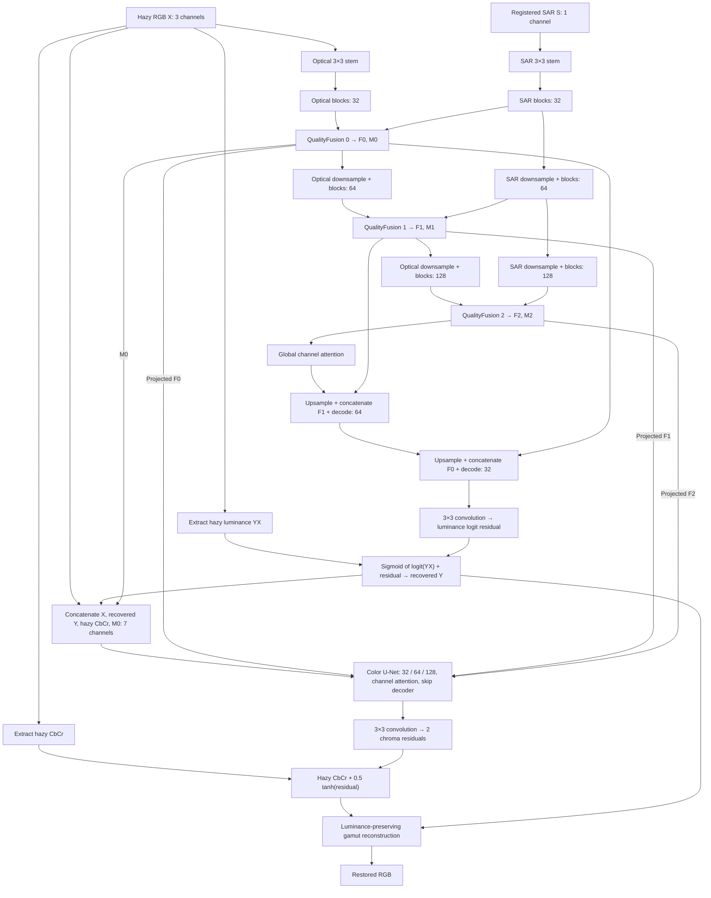

# SAR-guided structure recovery and optical color restoration

## 1. Purpose, scope, and evidence

This document explains the model implemented and trained in this repository, maps its mathematical operations to the source code, and provides material for a thesis's **proposed method**, **experimental setup**, and **results** chapters.

The implemented model is named **SARGrayColor**. It restores a haze-free optical RGB image from a registered pair consisting of hazy optical RGB and SAR. Its central design is a supervised, differentiable decomposition:

1. Recover optical luminance, using optical observations and spatially selective SAR guidance.
2. Restore optical chrominance, conditioned on the recovered luminance, observed optical colors, and features from the first stage.
3. Combine luminance and chrominance with a gamut constraint that preserves the recovered luminance.

**A consequential distinction for the thesis:** the saved training notebook actually completed **50 end-to-end epochs with batch size 10 and an 11-hour session budget**. The standalone YAML still specifies **6 epochs, batch size 4, and an 8-hour budget**. Describe the executed notebook configuration when reporting the saved experimental results. Some prose in README.md, TRAINING.md, and the notebook's Markdown cells describes the earlier defaults.

### 1.1 Evidence hierarchy

| Evidence | What it establishes | Location |
| --- | --- | --- |
| Python implementation | Exact architecture, losses, data handling, optimization, evaluation | [graytocolor/model.py](graytocolor/model.py), [train.py](train.py), [infer.py](infer.py) |
| Executed training configuration and logs | Settings actually used; all 50 completed epochs; validation history | [train_kaggle.ipynb](train_kaggle.ipynb), configuration cell `faa929b1`, training cell `1b20bd2d` |
| Executed testing outputs | Selected checkpoint epoch; complete 2,000-image test results; exported-PNG results | [test_kaggle.ipynb](test_kaggle.ipynb), cells `0fe5221c`, `d6a2cdec`, `b81a6a97`, `2ad9f05a` |
| Standalone YAML | Defaults for a new command-line run without notebook overrides | [mrshaze.yaml](mrshaze.yaml) |
| Synthetic tests | Intended implementation invariants and integration checks | [test_framework.py](test_framework.py) |
| Interpretations and proposed experiments below | Explanations or future work, explicitly distinguished from measured results | Sections 15–18 |

Notebook cells are identified by their stored `id`, because displayed cell numbers depend on the notebook viewer. The two executed notebooks are the source of the quantitative results reproduced here. The dataset, checkpoint binaries, full per-image CSV, and separate run directories are not present in this checkout; the scores have not been independently recomputed from images.

Documentation audit date: **2026-11-02**. Checkout revision: `9a05a9019c8acbd45ce16863e4cbb2162ff4da08`. The executed training notebook reports revision `1d5dbc98a52333dcf0eced096c99d064c871753b`; testing reports `31a9bd5a89aa6a05e8be18c5f4488bda6e41688b`. Comparing the training revision with this checkout shows no changes to `graytocolor/`, `train.py`, `infer.py`, `evaluate.py`, `mrshaze.yaml`, or `requirements.txt`.

The relative code links below use GitHub-style line anchors. Line numbers refer to the audited source revision; use the named class or function if later edits move them.

### 1.2 Reading guide

- **Proposed method:** [formulation](#2-problem-formulation-and-notation), [architecture diagram](#3-complete-forward-architecture), [building blocks](#4-building-blocks-shared-by-both-networks), [structure stage](#5-stage-1-sar-guided-optical-luminance-recovery), [color stage](#6-stage-2-structure-conditioned-optical-color-restoration), [reconstruction constraint](#7-color-representation-and-luminance-preserving-reconstruction), [gradient flow](#8-cross-stage-gradients-training-modes-and-model-outputs), [parameter counts](#9-architecture-size-and-layer-accounting), and [losses](#10-training-objective-term-by-term).
- **Experimental setup:** [data and preprocessing](#11-dataset-split-preprocessing-and-augmentation), [executed training protocol](#12-executed-training-protocol-and-optimization), and [evaluation definitions](#13-inference-and-exact-evaluation-definitions).
- **Results:** [recorded measurements and their limits](#14-results-supported-by-the-saved-notebooks).
- **Further experiments and thesis writing:** [experiment designs](#15-experiments-that-would-strengthen-the-thesis), [draft thesis prose](#16-thesis-writing-material), [reproducibility and analysis scripts](#17-reproducing-the-record-and-recovering-analysis-data), and [code cross-reference](#18-code-map-and-final-terminology-reference).

## 2. Problem formulation and notation

For each registered training triplet, let:

| Symbol | Meaning | Tensor layout |
| --- | --- | --- |
| $X$ | Hazy optical RGB input | $B\times3\times H\times W$ |
| $S$ | SAR input | $B\times C_s\times H\times W$; $C_s=1$ in the executed run |
| $J$ | Haze-free optical RGB reference | $B\times3\times H\times W$ |
| $Y_X,\ C_X$ | Luminance and two chrominance channels extracted from $X$ | One and two channels, respectively |
| $Y_J,\ C_J$ | Corresponding reference quantities | One and two channels |
| $\widehat Y$ | Recovered optical luminance | $B\times1\times H\times W$ |
| $F_i$ | Fused structure feature at level $i$ | $B\times C_i\times H_i\times W_i$ |
| $M_i$ | Learned fusion-region map at level $i$ | $B\times1\times H_i\times W_i$ |
| $\widehat C$ | Predicted chrominance before gamut contraction | $B\times2\times H\times W$ |
| $\widehat J$ | Restored optical RGB output | $B\times3\times H\times W$ |

All images use channel-first PyTorch tensors. Optical values are normalized to $[0,1]$. Chrominance is centered on zero.

The model can be written as:

$$
(\widehat Y,\{F_i\},\{M_i\})=G_\theta(X,S),
\tag{1}
$$

$$
\widehat C=C_X+\frac12\tanh\!\left(
R_\phi(X,\widehat Y,C_X,M_0;\{F_i\})
\right),
\tag{2}
$$

$$
\widehat J=\mathcal P(\widehat Y,\widehat C),
\tag{3}
$$

where $G_\theta$ is the structure network, $R_\phi$ is the color network up to its two-channel output, and $\mathcal P$ is the luminance-preserving RGB reconstruction.

**Meaning of “structure.”** The directly supervised intermediate image is optical luminance. The first network also learns features useful for final reconstruction. There is no explicit semantic segmentation, depth, or physical scene-geometry target.

**Meaning of “color restoration.”** This is conditional restoration of colors already observed in hazy optical RGB, with learned residual corrections. The system does not infer optical color solely from SAR or from an isolated grayscale image.

**Registration assumption.** The loader checks equal spatial dimensions and filename correspondence. It does not establish pixel-level registration or correct misalignment. The input dataset must already supply registered modalities.

**Code:** [SARGrayColor](graytocolor/model.py#L181), [input checks and forward pass](graytocolor/model.py#L192), [paired dataset loading](graytocolor/data.py#L131).

## 3. Complete forward architecture



There are **two U-Net-like encoder–decoder networks**, with independent weights. The first has separate optical and SAR encoder streams. The second has one encoder stream receiving optical/color inputs and projected structure features.

Both networks have **three spatial levels and two downsampling operations**, with widths $[32,64,128]$. The setting `depth=2` means two gated blocks in each encoder or decoder block stack. It does not mean two resolution levels.

Fusion is progressive along the optical stream: fused features from one level are downsampled to form the next optical-level input. The SAR stream continues independently through its own blocks and downsampling layers; fused optical features are not fed back into the SAR stream.

**Code:** [StructureNet construction](graytocolor/model.py#L96), [StructureNet forward](graytocolor/model.py#L117), [ColorNet](graytocolor/model.py#L144), [width configuration](graytocolor/model.py#L188).

## 4. Building blocks shared by both networks

### 4.1 Channel normalization

At each pixel, normalization is performed over feature channels:

$$
\mu_{b,u,v}=\frac1C\sum_{c=1}^{C}x_{b,c,u,v},
\qquad
\sigma^2_{b,u,v}=\frac1C\sum_c(x_{b,c,u,v}-\mu_{b,u,v})^2,
$$

$$
\operatorname{CN}(x)_{b,c,u,v}
=\gamma_c\frac{x_{b,c,u,v}-\mu_{b,u,v}}
{\sqrt{\sigma^2_{b,u,v}+10^{-6}}}+\beta_c.
\tag{4}
$$

The learned affine parameters have shape $1\times C\times1\times1$. They are initialized to $\gamma_c=1,\ \beta_c=0$.

This operation uses no batch statistics, spatial statistics, or running averages. Its normalization behavior is the same in training and evaluation.

**Code:** [ChannelNorm](graytocolor/model.py#L11). Relevant members: `weight`, `bias`; relevant operation: `x.mean(1, keepdim=True)`.

### 4.2 Depthwise gated residual block

Each `GatedBlock(C)` performs:

1. Channel normalization.
2. A $1\times1$ convolution expanding $C$ channels to $2C$.
3. A depthwise $3\times3$ convolution over all $2C$ channels, with padding one.
4. Splitting the result into two $C$-channel tensors $A,B$.
5. Elementwise gating $\operatorname{GELU}(A)\odot B$.
6. A $1\times1$ projection back to $C$.
7. A scaled residual addition.

$$
[A,B]=\operatorname{DWConv}_{3\times3}
\left(\operatorname{Conv}_{1\times1}^{C\rightarrow2C}(\operatorname{CN}(x))\right),
$$

$$
\operatorname{GB}(x)
=x+\lambda\odot
\operatorname{Conv}_{1\times1}^{C\rightarrow C}
\left(\operatorname{GELU}(A)\odot B\right).
\tag{5}
$$

The learned per-channel residual scale $\lambda$ starts at 0.1. The second gate branch $B$ is not passed through a sigmoid; the block's feature gate is therefore not a probability.

The depthwise convolution extracts local spatial information independently in each expanded channel. The pointwise convolutions mix channels. The residual path lets the stack learn corrections to the incoming features.

With convolution biases included, a block contains $3C^2+26C$ parameters: 3,904 at $C=32$, 13,952 at $C=64$, and 52,480 at $C=128$.

**Code:** [GatedBlock](graytocolor/model.py#L24), [repeated block stacks](graytocolor/model.py#L65).

### 4.3 Global channel attention at each bottleneck

Each network applies one `ChannelAttention(128)` module at its coarsest level.

The module normalizes its input, projects it to $Q,K,V$ with a pointwise convolution, and applies a depthwise $3\times3$ convolution. It reshapes these tensors to:

$$
Q,K,V\in\mathbb R^{B\times h\times d\times N},
\qquad d=C/h,\quad N=H_2W_2.
$$

The number of heads is $h=\gcd(C,4)$, hence $h=4$ and $d=32$ in the executed model.

After normalizing $Q,K$ along the spatial-vector axis $N$:

$$
A=\operatorname{softmax}_{\text{last}}
\left(\tau\,\overline Q\,\overline K^{\mathsf T}\right),
\qquad
A\in\mathbb R^{B\times h\times d\times d},
$$

$$
\operatorname{CA}(x)
=x+\operatorname{Conv}_{1\times1}
\left(\operatorname{reshape}(AV)\right).
\tag{6}
$$

Here $\tau$ is a learned scalar multiplier per head, initialized to one. The implementation multiplies by this parameter; it does not divide by a fixed $\sqrt d$.

**What is global:** channel correlations are estimated from all spatial positions available to the module. For a $256\times256$ crop, the bottleneck has $64\times64=4,096$ positions.

**What is attended:** the attention matrix relates channels within each head. At the default bottleneck it has four $32\times32$ matrices per image. It does not contain a $4,096\times4,096$ spatial-token matrix, and it is not optical–SAR cross-attention. Channel mixing is conditioned on global spatial evidence.

The attention-score storage scales as $h(C/h)^2$ rather than $N^2$; storing and applying features still depends on image size. Correlation, normalization of $Q,K$, softmax, and the attention–value product are explicitly computed in fp32 under mixed precision.

**Code:** [ChannelAttention](graytocolor/model.py#L39), [structure context](graytocolor/model.py#L134), [color context](graytocolor/model.py#L172).

## 5. Stage 1: SAR-guided optical luminance recovery

### 5.1 Dual encoders and spatial dimensions

Separate $3\times3$, stride-one, padding-one stems project RGB and SAR to 32 channels:

$$
O_0^{\mathrm{in}}=\operatorname{Conv}_{3\times3}^{3\rightarrow32}(X),
\qquad
S_0^{\mathrm{in}}=\operatorname{Conv}_{3\times3}^{1\rightarrow32}(S).
$$

At each level $i$, both streams pass through two gated blocks:

$$
O_i=\operatorname{GB}_i^{O}(O_i^{\mathrm{in}}),
\qquad
E_i=\operatorname{GB}_i^{S}(S_i^{\mathrm{in}}).
$$

Here a superscripted block stack means two independently parameterized blocks. Optical and SAR encoder weights are not shared.

| Level | Width $C_i$ | Size for a $256\times256$ crop | Main stored tensors |
| --- | ---: | --- | --- |
| 0 | 32 | $256\times256$ | $F_0:\ B\times32\times256\times256$; $M_0:\ B\times1\times256\times256$ |
| 1 | 64 | $128\times128$ | $F_1:\ B\times64\times128\times128$; $M_1:\ B\times1\times128\times128$ |
| 2 | 128 | $64\times64$ | $F_2:\ B\times128\times64\times64$; $M_2:\ B\times1\times64\times64$ |

Downsampling is learned through $3\times3$, stride-two, padding-one convolutions. For arbitrary dimensions, each downsampling produces $\lceil H/2\rceil\times\lceil W/2\rceil$. Decoder interpolation explicitly matches stored skip sizes, so dimensions need not be divisible by four.

**Code:** [encoder definitions](graytocolor/model.py#L100), [encoder loop](graytocolor/model.py#L121).

### 5.2 QualityFusion: feature projection, region estimation, and reliability gating

One `QualityFusion(C_i)` operates at each level. The following equations describe a single level; $[\,\cdot\,]$ denotes channel concatenation and $\odot$ elementwise multiplication.

**Step A: project SAR into the optical feature space.**

$$
\widetilde E_i=\operatorname{Conv}_{1\times1}(E_i).
\tag{7}
$$

The member is named `align`, but this is a learned channel-space projection. A $1\times1$ convolution cannot estimate spatial displacement or perform image registration.

**Step B: estimate a spatial fusion-region map.**

$$
M_i=\operatorname{sigmoid}
\left[
\operatorname{Conv}_{3\times3}^{C_i\rightarrow1}
\left(
\operatorname{GELU}
\left(
\operatorname{Conv}_{1\times1}^{3C_i\rightarrow C_i}
[O_i,\widetilde E_i,|O_i-\widetilde E_i|]
\right)\right)\right].
\tag{8}
$$

The discrepancy tensor $|O_i-\widetilde E_i|$ makes cross-modal differences available to the region predictor. The map has one value per pixel and is broadcast across channels.

Its role is to control where the fusion block may modify optical features. The paired supervision described in Section 10 encourages it to respond to optical corruption. It is not a physical atmospheric transmission estimate.

**Step C: compute a coarse fused representation.**

$$
U_i=\operatorname{GB}
\left(
\operatorname{Conv}_{1\times1}^{2C_i\rightarrow C_i}
[(1-M_i)\odot O_i,\ M_i\odot\widetilde E_i]
\right).
\tag{9}
$$

**Step D: estimate feature reliability.**

$$
Q_i=\operatorname{sigmoid}
\left(\operatorname{Conv}_{1\times1}^{C_i\rightarrow C_i}(U_i)\right).
\tag{10}
$$

Unlike $M_i$, $Q_i$ has shape $B\times C_i\times H_i\times W_i$: reliability varies by channel and spatial location. It is learned through the restoration objective and has no direct reliability labels.

**Step E: refine the fusion and add an optical residual path.**

$$
V_i=\operatorname{GB}
\left(
\operatorname{Conv}_{1\times1}^{3C_i\rightarrow C_i}
[Q_i\odot O_i,\ (1-Q_i)\odot\widetilde E_i,\ U_i]
\right),
$$

$$
F_i=O_i+M_i\odot V_i.
\tag{11}
$$

When $M_i$ approaches zero, the output approaches $O_i$. When it approaches one, the learned correction can contribute fully. The final feature is not a convex average of optical and SAR features: $V_i$ is an unrestricted learned feature correction.

This block contains two different kinds of gates:

| Gate | Shape | Function | Direct supervision |
| --- | --- | --- | --- |
| $M_i$, code variable `haze` | $B\times1\times H_i\times W_i$ | Spatial control of fusion and residual correction | Soft optical-difference proxy |
| $Q_i$, code variable `quality` | $B\times C_i\times H_i\times W_i$ | Channel- and position-dependent weighting before refinement | None |

Neither gate is a calibrated uncertainty estimate. The implementation does not export $Q_i$ in the model's output dictionary.

**Code:** [QualityFusion definition](graytocolor/model.py#L69), [its complete forward computation](graytocolor/model.py#L86).

### 5.3 Decoder and feature connections

After producing $F_2$, the structure network applies bottleneck channel attention. It then decodes from level 2 to level 0:

$$
D_2=\operatorname{CA}(F_2),
$$

$$
D_i=\operatorname{GB}_i^{\mathrm{dec}}
\left(
\operatorname{Conv}_{1\times1}^{C_{i+1}+C_i\rightarrow C_i}
[\operatorname{Up}(D_{i+1}),F_i]
\right),
\quad i=1,0.
\tag{12}
$$

Upsampling is bilinear with `align_corners=False`, targeting the exact skip dimensions.

| Decoder operation | Concatenated channels | After $1\times1$ projection |
| --- | ---: | ---: |
| Level 2 → 1 | $128+64=192$ | 64 |
| Level 1 → 0 | $64+32=96$ | 32 |

The decoder's two-block stacks refine the projected features.

The `features` list exported to the color network contains the **encoder fusion outputs $F_0,F_1,F_2$, before bottleneck attention**. It does not contain structure-decoder activations. This distinction matters when drawing cross-stage arrows in a thesis figure.

**Code:** [feature storage](graytocolor/model.py#L128), [structure decoder](graytocolor/model.py#L134).

### 5.4 Luminance prediction as a residual in logit space

The full-resolution decoder predicts one channel:

$$
\Delta_Y=\operatorname{Conv}_{3\times3}^{32\rightarrow1}(D_0).
$$

The hazy luminance is bounded away from zero and one:

$$
\widetilde Y_X=\operatorname{clip}(Y_X,10^{-4},1-10^{-4}),
$$

$$
\widehat Y=\operatorname{sigmoid}
\left(\operatorname{logit}(\widetilde Y_X)+\Delta_Y\right).
\tag{13}
$$

This makes the recovered luminance lie in $(0,1)$ and gives the network a correction relative to observed luminance. If $\Delta_Y=0$, the output equals the clamped hazy luminance. The model can darken or brighten the input.

The output convolution's weights are initialized from a normal distribution with standard deviation 0.01, and its bias is zero. The initial behavior is consequently biased toward a small residual, but it is not an exactly initialized identity mapping.

The residual is added to a **logit**, not directly to $Y_X$, and not directly to RGB.

**Code:** [output initialization](graytocolor/model.py#L113), [logit residual](graytocolor/model.py#L139).

## 6. Stage 2: structure-conditioned optical color restoration

### 6.1 Seven-channel input

The color network concatenates:

$$
Z_0=[X,\widehat Y,C_X,M_0]
\in\mathbb R^{B\times7\times H\times W}.
\tag{14}
$$

| Input | Channels | Information supplied |
| --- | ---: | --- |
| Hazy RGB $X$ | 3 | Original optical observations |
| Recovered luminance $\widehat Y$ | 1 | Restored grayscale appearance |
| Hazy chrominance $C_X=(Cb_X,Cr_X)$ | 2 | Explicit optical color evidence |
| Finest region map $M_0$ | 1 | Learned spatial conditioning |
| **Total** | **7** | Input to `ColorNet.stem` |

Although $C_X$ can be computed from $X$, supplying it explicitly exposes the model's intended luminance–chrominance decomposition.

**Code:** [seven-channel stem](graytocolor/model.py#L148), [input concatenation](graytocolor/model.py#L161).

### 6.2 Multiscale structure-feature injection

At each color-encoder level, the matching fused structure feature is projected by a learned $1\times1$ convolution and added before the color block stack:

$$
Z_i^{\mathrm{guided}}=Z_i^{\mathrm{in}}+
\operatorname{Conv}_{1\times1}^{C_i\rightarrow C_i}(F_i),
$$

$$
E_i^{C}=\operatorname{GB}_i^{C}(Z_i^{\mathrm{guided}}).
\tag{15}
$$

These are additive feature connections, not concatenation or cross-attention. Each connection has its own projection weights. They let color prediction access multimodal features beyond the single recovered grayscale channel.

The color encoder follows the same widths and downsampling pattern as the structure encoder. It has its own bottleneck channel attention and its own skip decoder. Its decoder uses color-encoder skips $E_i^C$; the structure features enter through the color encoder.

**Code:** [guidance projections](graytocolor/model.py#L150), [feature addition](graytocolor/model.py#L165), [color decoder](graytocolor/model.py#L172).

### 6.3 Residual chrominance prediction

The color decoder produces two residual channels:

$$
\Delta_C=\operatorname{Conv}_{3\times3}^{32\rightarrow2}(D_0^C),
\qquad
\widehat C=C_X+0.5\tanh(\Delta_C).
\tag{16}
$$

Each chrominance correction is bounded to $(-0.5,0.5)$. The provisional $\widehat C$ itself is not clipped to a fixed chrominance interval; RGB feasibility is handled by the reconstruction step.

The color output convolution uses the same small-weight, zero-bias initialization as the luminance head. Near-zero residuals retain the observed hazy chrominance before gamut mapping. This favors learning a correction to optical colors.

The colorizer returns RGB after reconstruction. The top-level output named `chroma` is computed back from that RGB, so it represents the **realized, post-gamut chrominance**, not necessarily the provisional $\widehat C$.

**Code:** [color residual head](graytocolor/model.py#L157), [bounded correction and reconstruction](graytocolor/model.py#L177), [returned chrominance](graytocolor/model.py#L211).

## 7. Color representation and luminance-preserving reconstruction

### 7.1 Full-range BT.601-style luma and centered chroma

The implementation uses:

$$
Y=0.299R+0.587G+0.114B,
$$

$$
Cb=\frac{B-Y}{1.772},
\qquad
Cr=\frac{R-Y}{1.402}.
\tag{17}
$$

There is no $+0.5$ offset for chrominance in the internal tensors. There is no limited-range 16–235 scaling.

These operations are applied directly to normalized display RGB. There is **no sRGB linearization**, so the quantity called luminance or grayscale in the code is more precisely display-space **luma**. The thesis should define the actual transform instead of describing $Y$ as physical radiance.

**Code:** [rgb_to_ycbcr](graytocolor/color.py#L8).

### 7.2 RGB reconstruction and gamut contraction

For recovered $\widehat Y$ and provisional $(\widehat{Cb},\widehat{Cr})$, define RGB offsets:

$$
d_R=1.402\widehat{Cr},\qquad d_B=1.772\widehat{Cb},
$$

$$
d_G=-\frac{0.114(1.772)\widehat{Cb}
+0.299(1.402)\widehat{Cr}}{0.587}.
\tag{18}
$$

Without a gamut constraint, RGB would be $\widehat Y+[d_R,d_G,d_B]$, which can leave $[0,1]$.

At each pixel, for channel $c\in\{R,G,B\}$, compute:

$$
b_c=
\begin{cases}
\dfrac{1-\widehat Y}{\max(|d_c|,10^{-6})}, & d_c\ge0,\\[6pt]
\dfrac{\widehat Y}{\max(|d_c|,10^{-6})}, & d_c<0,
\end{cases}
\qquad
\alpha=\operatorname{clip}\left(\min_c b_c,0,1\right),
$$

$$
\widehat J_c=\widehat Y+\alpha d_c.
\tag{19}
$$

The same $\alpha$ contracts all three offsets at a pixel. This produces in-gamut RGB, up to numerical precision, while preserving the predicted luma:

$$
0.299d_R+0.587d_G+0.114d_B=0
\quad\Longrightarrow\quad
Y(\widehat J)=\widehat Y.
\tag{20}
$$

Uniform contraction also scales both chrominance channels by the same factor. It can reduce saturation when a requested chroma would violate the gamut.

The purpose is architectural: the color stage cannot freely replace the first stage's luma through an unconstrained RGB output head. The identity in Equation (20) holds with predicted grayscale at ordinary inference and joint training. During optional teacher mixing, the reconstructed RGB instead preserves the **mixed** grayscale supplied to the colorizer.

The reconstruction uses differentiable tensor operations, including piecewise operations such as absolute value, minimum, and clamping; gradients exist almost everywhere. Floating-point tolerances still apply, particularly under fp16.

**Code:** [ycbcr_to_rgb](graytocolor/color.py#L14). The luminance identity is checked in [color/gamut tests](test_framework.py#L53) and [gradient-routing tests](test_framework.py#L64).

## 8. Cross-stage gradients, training modes, and model outputs

### 8.1 End-to-end gradient flow

Under the executed `e2e` mode, the color reconstruction objectives can update the structure network along three paths:

1. **Recovered luminance:** $\widehat Y$ enters both the color-network input and the final RGB reconstruction.
2. **Multiscale features:** each $F_i$ is projected into the color encoder.
3. **Finest region map:** $M_0$ is part of the seven-channel color input.

Thus “two-stage” describes the forward computation and factorization of outputs; it does not imply separate optimization in the completed experiment.

If $\mathcal L_C$ denotes the color/RGB objective, the chain rule includes:

$$
\frac{\partial\mathcal L_C}{\partial\theta}
=
\frac{\partial\mathcal L_C}{\partial\widehat Y}
\frac{\partial\widehat Y}{\partial\theta}
+
\sum_i
\frac{\partial\mathcal L_C}{\partial F_i}
\frac{\partial F_i}{\partial\theta}
+
\frac{\partial\mathcal L_C}{\partial M_0}
\frac{\partial M_0}{\partial\theta}.
\tag{21}
$$

Auxiliary luminance and region-map objectives also train $\theta$. The decomposition therefore constrains the intermediate representation while allowing adaptation to the final RGB task.

### 8.2 Implemented training modes

| Mode | Phase schedule | Color-loss gradients into structure |
| --- | --- | --- |
| `e2e` | All configured phase lengths are summed and run as joint epochs | Enabled throughout |
| `hybrid` | Grayscale phase → color phase → joint phase, omitting zero-length phases | Enabled in the joint phase |
| `modular` | Same phase order as hybrid | Detached throughout; structure still receives its own losses in grayscale/joint phases |

In a grayscale phase, the colorizer is frozen and skipped. In a color phase, structure parameters are frozen and the connections to the colorizer are detached. In a joint phase, both parameter groups are trainable; modular mode additionally detaches the three structure-to-color paths.

`detach_structure=True` detaches grayscale, every feature, and the finest region map. Detaching only the grayscale image would leave two other routes for color gradients.

**Executed run:** `gray_epochs=0`, `color_epochs=0`, `joint_epochs=50`, `mode=e2e`. Both networks learn from the first batch.

**Code:** [phase_plan](train.py#L27), [set_phase](train.py#L38), [detach selection](train.py#L225), [complete cross-stage detachment](graytocolor/model.py#L203).

### 8.3 Optional teacher grayscale

This feature exists for a separately configured color warm-up and was **not used in the completed run**.

The grayscale supplied to the colorizer can be:

$$
Y_{\mathrm{color}}=(1-\rho)\operatorname{stopgrad}(\widehat Y)
+\rho\operatorname{stopgrad}(Y_J).
\tag{22}
$$

For a color phase with $E_C>1$ epochs, the ratio at zero-based phase epoch $e$ is:

$$
\rho_e=\texttt{teacher\_start}\left(1-\frac{e}{E_C-1}\right).
$$

It decreases linearly from 0.5 to zero under the default teacher setting. A one-epoch color phase uses predictions only. Joint phases and inference use no teacher. The model rejects teacher guidance in evaluation mode.

The returned `gray` remains the original predicted $\widehat Y$, even if the colorizer receives a mixed grayscale. This is relevant when interpreting intermediate outputs in a teacher-assisted experiment.

**Code:** [teacher schedule](train.py#L207), [training-only teacher interpolation](graytocolor/model.py#L206).

### 8.4 Forward interface and returned tensors

```python
model = SARGrayColor(
    width=32,
    depth=2,
    sar_channels=1,
    use_sar=True,
    use_structure_features=True,
)
output = model(hazy, sar)
```

| Output key | Shape | Meaning |
| --- | --- | --- |
| `rgb` | $B\times3\times H\times W$ | Restored optical RGB |
| `gray` | $B\times1\times H\times W$ | Predicted optical luma |
| `haze` | $B\times1\times H\times W$ | Finest learned fusion-region map $M_0$ |
| `haze_pyramid` | List of three one-channel tensors | $M_0,M_1,M_2$, used for multiscale proxy supervision |
| `chroma` | $B\times2\times H\times W$ | Chrominance recomputed from final RGB |

`structure_only=True` returns only `gray`, `haze`, and `haze_pyramid`. Intermediate $F_i$, reliability $Q_i$, and pre-gamut chroma are not returned by the top-level model.

The shape checks require a correctly shaped SAR tensor even with `use_sar=False`. Under that ablation the SAR tensor values do not affect the prediction and all region maps are zero.

**Code:** [SARGrayColor.forward](graytocolor/model.py#L192), [no-SAR branch](graytocolor/model.py#L126), [no-SAR test](test_framework.py#L88).

## 9. Architecture size and layer accounting

The executed model contains **1,326,414 registered parameters**, recorded by the training script and independently matched by counting the source-defined layers, including biases and normalization/scale parameters.

| Component | Structure network | Color network |
| --- | ---: | ---: |
| Optical or seven-channel input stem | 896 | 2,048 |
| SAR input stem | 320 | — |
| Optical or color encoder gated stacks | 140,672 | 140,672 |
| SAR encoder gated stacks | 140,672 | — |
| Three QualityFusion modules | 358,851 | — |
| Optical or color downsampling layers | 92,352 | 92,352 |
| SAR downsampling layers | 92,352 | — |
| Three feature-guidance projections | — | 21,728 |
| Bottleneck channel attention | 70,148 | 70,148 |
| Decoder concatenation projections | 15,456 | 15,456 |
| Decoder gated stacks | 35,712 | 35,712 |
| Output convolution | 289 | 578 |
| **Subtotal** | **947,720** | **378,694** |
| **Combined total** | **1,326,414** | |

Additional architectural accounting:

- Two bottleneck attention modules, each with four heads.
- Three fusion modules, with 18,497 / 69,761 / 270,593 parameters at widths 32 / 64 / 128.
- Thirty-two gated blocks in total: 22 in structure, including six inside fusion modules, and 10 in color.
- No pretrained backbone, adversarial discriminator, diffusion process, state-space/Mamba layer, or explicit atmospheric scattering inversion is instantiated.
- No spatial dropout layers are used. SAR modality dropout is applied by the training loop.

For a biased convolution with input/output channels $a,b$, kernel $k$, and groups $g$, the parameter count is $b(a/g)k^2+b$. The count above follows directly from these formulas and the declared modules; it does not represent a measured FLOP or memory benchmark.

**Ablation accounting:** `use_sar=False` skips the SAR/fusion computation but still constructs those modules. Similarly, `use_structure_features=False` skips guidance additions but still constructs their projections. The script's `sum(p.numel() for p in model.parameters())` therefore counts allocated parameters that may be inactive under these flags. Use separate active-parameter or compute measurements for efficiency comparisons.

**Code:** [architecture construction](graytocolor/model.py#L181), [recorded parameter count](train.py#L157).

## 10. Training objective, term by term

The joint loss is:

$$
\begin{aligned}
\mathcal L_{\mathrm{joint}}={}&
1.0\,\mathcal L_Y
+0.2\,\mathcal L_{Y,\mathrm{SSIM}}
+0.1\,\mathcal L_{\mathrm{edge}}
+0.05\,\mathcal L_{\mathrm{gate}}\\
&+1.0\,\mathcal L_{\mathrm{RGB}}
+0.5\,\mathcal L_{\mathrm{chroma}}
+0.2\,\mathcal L_{\mathrm{RGB},\mathrm{SSIM}}
+0.05\,\mathcal L_{\mathrm{frequency}}.
\end{aligned}
\tag{23}
$$

All eight terms are active in the executed end-to-end run, subject to SAR-availability masking for gate supervision.

| Term | Code key | Purpose | Source |
| --- | --- | --- | --- |
| Luma L1 | `gray` | Direct accuracy of the interpretable intermediate image | [losses.py](graytocolor/losses.py#L36) |
| Luma SSIM loss | `gray_ssim` | Local structural consistency in recovered luma | [losses.py](graytocolor/losses.py#L37) |
| Luma finite-difference loss | `edge` | Consistency of horizontal and vertical intensity changes | [edge_loss](graytocolor/losses.py#L9) |
| Multiscale region-map BCE | `gate` | Spatial guidance toward paired optical discrepancies | [losses.py](graytocolor/losses.py#L39) |
| RGB L1 | `rgb` | Final color-image reconstruction | [losses.py](graytocolor/losses.py#L57) |
| Chroma L1 | `chroma` | Explicit preservation/restoration of optical color components | [losses.py](graytocolor/losses.py#L58) |
| RGB SSIM loss | `rgb_ssim` | Local structural consistency of final RGB | [losses.py](graytocolor/losses.py#L59) |
| Complex-spectrum difference | `frequency` | Reconstruction agreement in the frequency domain | [frequency_loss](graytocolor/losses.py#L16) |

The weights come from [mrshaze.yaml](mrshaze.yaml#L38) and match the executed notebook's printed configuration. `gate_difference_scale=0.25` sets the proxy normalization; it is not an additional loss weight.

### 10.1 Luminance reconstruction

$$
\mathcal L_Y=\operatorname{mean}|\widehat Y-Y_J|,
\qquad
\mathcal L_{Y,\mathrm{SSIM}}
=\operatorname{mean}_{\mathrm{images}}\left[1-\operatorname{SSIM}(\widehat Y,Y_J)\right].
\tag{24}
$$

The SSIM loss is $1-\mathrm{SSIM}$, with no division by two.

### 10.2 Finite-difference edge consistency

Let $\nabla_v$ and $\nabla_h$ denote adjacent-pixel forward differences along height and width:

$$
\mathcal L_{\mathrm{edge}}=
\frac12\left(
\operatorname{mean}|\nabla_v\widehat Y-\nabla_vY_J|
+
\operatorname{mean}|\nabla_h\widehat Y-\nabla_hY_J|
\right).
\tag{25}
$$

The implementation uses simple differences, not Sobel kernels, learned edges, or a separate boundary detector.

### 10.3 RGB and realized-chroma reconstruction

$$
\mathcal L_{\mathrm{RGB}}=\operatorname{mean}|\widehat J-J|,
$$

$$
\mathcal L_{\mathrm{chroma}}
=\operatorname{mean}|C(\widehat J)-C_J|,
$$

$$
\mathcal L_{\mathrm{RGB},\mathrm{SSIM}}
=\operatorname{mean}_{\mathrm{images}}\left[1-\operatorname{SSIM}(\widehat J,J)\right].
\tag{26}
$$

The chroma term is evaluated after gamut reconstruction. This makes the loss supervise colors actually present in the final RGB, including any saturation reduction.

### 10.4 Frequency-domain reconstruction

$$
\mathcal L_{\mathrm{frequency}}
=\operatorname{mean}
\left|
\mathcal F_{\mathrm{rfft2}}^{\mathrm{ortho}}(\widehat J)
-
\mathcal F_{\mathrm{rfft2}}^{\mathrm{ortho}}(J)
\right|.
\tag{27}
$$

The two-dimensional real FFT is applied to each RGB channel in fp32 with orthonormal normalization. The code subtracts complex spectra and averages their complex magnitudes. It therefore compares phase as well as amplitude. It is not the absolute difference of amplitude spectra, nor the sum of separate absolute real/imaginary differences. It averages the stored one-sided frequency grid without an additional frequency weighting.

### 10.5 Multiscale fusion-region supervision

The target proxy is computed only during supervised training:

$$
P(u,v)=\operatorname{clip}
\left(
\frac{\frac13\sum_{c=1}^{3}|X_c(u,v)-J_c(u,v)|}{0.25},
0,1
\right).
\tag{28}
$$

For each level, the proxy is resized by area interpolation:

$$
P_i=\operatorname{AreaResize}(P,H_i,W_i),
$$

$$
\mathcal L_{\mathrm{gate}}
=\frac13\sum_{i=0}^{2}
\operatorname{BCE}(M_i,P_i).
\tag{29}
$$

BCE is applied to the sigmoid maps, after clamping predictions to $[10^{-6},1-10^{-6}]$. Labels are soft values, not binary haze masks.

When SAR dropout is active, the BCE reduction includes only samples retaining SAR:

$$
\mathcal L_{\mathrm{gate},i}
=
\frac{\sum_{b,u,v}a_b\,\ell_{\mathrm{BCE}}(M_{i,b,u,v},P_{i,b,u,v})}
{\max\left((\sum_ba_b)H_iW_i,1\right)},
\quad a_b\in\{0,1\}.
\tag{30}
$$

If no sample retains SAR, the gate term is zero. The three levels are averaged equally.

This is **proxy supervision based on paired optical differences**. It cannot distinguish haze from every other possible discrepancy, such as registration error or scene change. It does not directly supervise $Q_i$, and it does not require reference images at inference.

Because labels are soft, a nonzero BCE value does not itself show failed training: the BCE optimum for a soft target generally has a nonzero entropy.

### 10.6 Phase-dependent loss activation

| Phase | Active terms | Trainable subnetworks |
| --- | --- | --- |
| Grayscale | `gray`, `gray_ssim`, `edge`, and `gate` with SAR | Structure |
| Color | `rgb`, `chroma`, `rgb_ssim`, `frequency` | Colorizer |
| Joint | Both sets | Both, with cross-stage gradients determined by mode |

Loss calculations explicitly disable autocast and use fp32. The logged component values are **unweighted** losses. The logged `train.total` is their weighted sum, averaged over training samples. This total is not directly comparable to any single component's scale.

**Code:** [RestorationLoss.forward](graytocolor/losses.py#L28), [total formation](graytocolor/losses.py#L62), [sample-weighted logging](train.py#L246).

## 11. Dataset, split, preprocessing, and augmentation

### 11.1 Dataset as consumed by this project

The supplied dataset is identified as MRSHaze. The local dataset-path note and executed notebooks describe:

```text
MRSHaze/
  train/
    hazy/01001.png ... 07000.png
    SAR/01001.png  ... 07000.png
    GT/01001.png   ... 07000.png
  test/
    hazy/00001.png ... 01000.png, 07001.png ... 08000.png
    SAR/<matching IDs>.png
    GT/<matching IDs>.png
```

| Partition | Images | Role |
| --- | ---: | --- |
| Dataset training partition | 6,000 triplets | Source for optimization/validation split |
| Optimization subset | 5,400 triplets | Gradient updates |
| Validation holdout | 600 triplets | Checkpoint selection |
| Preserved dataset test partition | 2,000 triplets | Final reported evaluation |

Folder matching is case-insensitive. Pairing is by the complete filename stem. Missing/extra modality IDs, duplicate IDs, and mismatched image dimensions cause errors.

The counts 5,400 and 600 are confirmed by the executed training log; 2,000 is confirmed by both test summaries. The filename ranges are described in [tp.md](tp.md). This repository does not establish sensor provenance, geographic distribution, haze-generation parameters, geospatial separation, or an official dataset citation. Obtain those details from the dataset's original documentation before writing that part of the thesis.

**Code:** [folder and image indexing](graytocolor/data.py#L22), [strict pairing](graytocolor/data.py#L42).

### 11.2 Deterministic validation holdout

The loader starts with sorted records. A local `random.Random(42)` shuffles the IDs, and the first $\operatorname{round}(6000\times0.1)=600$ become validation IDs. The rest are used for optimization.

The manifest records exact train/validation IDs and `source_split='train'`. On resume, it is checked for disjointness, duplicates, completeness, and nonempty subsets. Training never opens the dataset's test partition.

This is an image-ID holdout. The code does not group samples by geography, acquisition date, or parent scene. Disjoint IDs alone do not prove geographic independence.

**Code:** [make_split](graytocolor/data.py#L59), [training split creation](train.py#L94), [manifest writing](graytocolor/data.py#L163).

### 11.3 Optical preprocessing

Optical PNGs are converted to RGB, cast to float32, divided by 255, and transposed from $HWC$ to $CHW$. There is no ImageNet normalization, per-image standardization, histogram matching, or color-space linearization.

The loader expects supported 8-bit optical image modes; it is not a general multispectral or high-bit-depth optical loader.

**Code:** [load_rgb](graytocolor/data.py#L80).

### 11.4 SAR preprocessing

The executed configuration is:

```yaml
sar_channels: 1
sar_scale: null
sar_log1p: false
```

With no custom scale, unsigned integer PNGs are divided by their dtype maximum, such as 255 for uint8 or 65,535 for uint16. A one-channel rendering stored as RGB/RGBA is converted by averaging its first three channels. A two-channel array is not silently averaged into one channel.

If multichannel SAR is used, the requested channel count must match the stored channels, and `data.sar_channels` must match `model.sar_channels`.

The optional logarithmic transform, unused here, is:

$$
S_{\log}=\frac{\log(1+S)}{\log2}.
$$

There is no per-image min–max normalization or explicit SAR speckle filter. This preprocessing handles normalized PNG renderings; it does not implement raw-SAR calibration, terrain correction, or registration.

**Code:** [load_sar](graytocolor/data.py#L88), [matching-channel configuration check](graytocolor/runtime.py#L24).

### 11.5 Synchronized training augmentation

Every training access applies the same geometry to hazy RGB, SAR, and GT:

1. Replicate-pad the right/bottom edges if either dimension is below 256.
2. Select one random $256\times256$ crop.
3. Rotate by a uniformly sampled $0^\circ,90^\circ,180^\circ,$ or $270^\circ$.
4. Apply a horizontal flip with probability 0.5.

The rotation/flip combinations form the eight dihedral orientations. Training samples are reshuffled each epoch and receive newly sampled augmentations.

There are no independent modality crops or flips, and no photometric color-jitter augmentation. The grayscale target and region proxy are derived from the augmented optical tensors during loss evaluation.

Validation and test use complete native-resolution images with no random crops, rotations, or flips. The actual native image dimensions are not printed in the saved logs; a $256\times256$ training crop does not establish the native test resolution.

**Code:** [paired augmentation](graytocolor/data.py#L140), [training/validation dataset construction](train.py#L101), [augmentation tests](test_framework.py#L109).

### 11.6 SAR modality dropout

For each training image, an availability variable is sampled:

$$
a_b\sim\operatorname{Bernoulli}(0.9),
\qquad
S_b^{\mathrm{train}}=a_bS_b.
\tag{31}
$$

A dropped sample therefore has an all-zero SAR input. This happens per image, not per pixel or per feature channel. The SAR branch still executes, and its biases may produce nonzero features; the code does not hard-bypass fusion on a dropped sample.

Dropped samples keep their reconstruction losses but are excluded from the direct gate BCE. The model is not explicitly given the availability flag as an input.

The design encourages reduced dependence on SAR. Robustness to missing, shifted, or corrupted SAR still requires a dedicated evaluation; the dropout setting alone does not establish that result.

**Code:** [availability sampling and SAR masking](train.py#L217), [gate masking](graytocolor/losses.py#L48).

## 12. Executed training protocol and optimization

### 12.1 Actual notebook settings versus standalone defaults

| Setting | Executed training notebook | Standalone YAML default |
| --- | --- | --- |
| Mode | `e2e` | `e2e` |
| Grayscale / color / joint epochs | **0 / 0 / 50** | 0 / 0 / 6 |
| Completed epochs | **50**, confirmed by saved logs | A configuration alone establishes no completed epochs |
| Batch size | **10** | 4 |
| Session time budget | **11 hours** | 8 hours |
| Crop size | $256\times256$ | Same |
| Gradient accumulation | 1 | Same |
| Width / depth | 32 / 2 | Same |
| Seed | 42 | Same |
| Validation holdout | 10% of training partition | Same |
| Optimization / validation images | 5,400 / 600 | Same when using this dataset |
| Training loader workers | 2 | Same |
| Validation batch size / workers | 1 / 0 | Same |
| Development subset limits | Both null | Same |
| SAR dropout | 0.1 | Same |
| Teacher ratio actually used | 0 at every epoch | No teacher in the default joint-only schedule |

The executed notebook sets `RESUME=None`, `INIT_WEIGHTS=None`, and `STOP_AFTER_EPOCH=None`. This is a fresh 50-epoch run from random initialization, with no pretrained weight loading in the recorded invocation.

At batch size 10, each epoch has $5400/10=540$ batches. The 50 logs each record 540 attempted optimizer updates, totaling **27,000**. With accumulation one, the effective batch size is 10 on the single selected GPU.

The inference output uses the checkpoint from epoch 49, while training completed epoch 50. These are different facts: report both.

### 12.2 Hardware and software recorded by execution

| Item | Recorded value | Evidence |
| --- | --- | --- |
| GPU | NVIDIA Tesla T4 | Executed setup cells |
| PyTorch | `2.11.0+cu128` | Setup and training metadata |
| Python | `3.13.15` | Training metadata |
| Training device | `cuda` | Effective configuration |
| Training mixed precision | CUDA fp16 autocast with gradient scaling | Effective config and training code |
| Testing mixed precision | Disabled; fp32 inference | Test command and summary `amp: false` |
| Parallelism | One selected GPU; no DDP/DataParallel | Training implementation |

The notebook metadata's `isGpuEnabled` field is false, but the executed outputs explicitly show `CUDA: True`, a Tesla T4, and CUDA training. Use those runtime outputs as evidence of the executed device. Do not infer CPU training from that metadata field.

`requirements.txt` specifies minimum versions rather than a fully pinned environment. The record does not include every package version, CUDA-driver version, GPU memory measurement, or CPU/RAM specification.

### 12.3 AdamW and parameter-group learning rates

One AdamW optimizer has two groups: structure and colorizer. Both use weight decay $10^{-4}$. No special bias or normalization exclusions are declared.

The run does not override AdamW's library defaults for betas and epsilon. There is no separate optimizer for each stage.

In joint training:

$$
\eta_{\mathrm{color}}(t)=\eta(t),
\qquad
\eta_{\mathrm{structure}}(t)=0.5\,\eta(t).
\tag{32}
$$

The base peak is $2\times10^{-4}$, and the base floor is $10^{-6}$. Thus the corresponding structure peak/floor are $10^{-4}$ and $5\times10^{-7}$. The printed `lr` is the base/color rate, not the smaller structure rate.

**Code:** [optimizer groups](train.py#L116), [per-batch group rates](train.py#L221).

### 12.4 Warm-up and cosine schedule

The learning rate is recomputed before every batch. Let $e$ be the zero-based phase epoch, $k$ the zero-based batch index, $K$ the number of batches, $E$ the phase length, and $p=e+k/K$.

$$
w=\min(\texttt{warmup\_epochs},\max(0,E-1)).
$$

During warm-up:

$$
\eta(p)=\eta_{\min}
+(\eta_{\max}-\eta_{\min})\frac{p+10^{-3}}{w},
\quad p<w.
\tag{33}
$$

Afterward:

$$
f=\operatorname{clip}
\left(\frac{p-w}{\max(1,E-w)},0,1\right),
$$

$$
\eta(p)=\eta_{\min}
+\frac12(\eta_{\max}-\eta_{\min})[1+\cos(\pi f)].
\tag{34}
$$

For the recorded experiment, $E=50$ and $w=1$: one warm-up epoch followed by cosine decay over the remaining schedule. Since updates happen at batch positions below the terminal endpoint, the last logged learning rate can be slightly above the nominal floor.

For hybrid/modular experiments, this schedule restarts within each nonempty phase. An initial segment of a 50-epoch schedule is therefore not equivalent to a separately configured six-epoch experiment.

**Code:** [learning_rate](train.py#L45).

### 12.5 Backpropagation, precision, and gradient stabilization

The core iteration is equivalent to:

```python
# Simplified explanation of the implemented joint-training path.
set_learning_rates(base_lr, structure_multiplier=0.5)
sar_input = sar * sample_per_image_availability(p_keep=0.9)

with cuda_fp16_autocast():
    output = model(hazy, sar_input)
    loss = restoration_loss(output, hazy, gt, sar_available)

scaled_loss = scaler.scale(loss / current_accumulation_group_size)
scaled_loss.backward()

if accumulation_group_complete:
    scaler.unscale_(optimizer)
    clip_grad_norm_(model.parameters(), max_norm=1.0)
    scaler.step(optimizer)
    scaler.update()
    optimizer.zero_grad(set_to_none=True)
```

This is explanatory pseudocode; helper names above are descriptive. The exact executable code is [the training loop](train.py#L211).

At accumulation one, every batch attempts an optimizer update. AMP can skip updates if nonfinite gradients occur, so the logged count is an **attempt count**, not proof that every attempt changed the weights. Nonfinite total loss raises an error.

The accumulation implementation correctly divides a final shorter accumulation group by its actual batch count. That feature was available but unnecessary for this run.

### 12.6 Validation, model selection, and checkpoints

Validation occurs after every completed epoch in the executed run. It uses inference mode, `model.eval()`, native-resolution images, and no training autocast context. The validation metrics are therefore computed from fp32 model inference.

The best joint checkpoint is selected by **mean validation RGB PSNR**:

$$
e^\star=\arg\max_e\operatorname{PSNR}_{\mathrm{validation}}(e).
\tag{35}
$$

The maximum occurs at epoch **49**. The last epoch has slightly higher validation SSIM but slightly lower PSNR, so it is not selected.

| Artifact | Meaning for this run |
| --- | --- |
| `last.pt` | Last completed epoch; epoch 50 at the end of the recorded run |
| `best_joint.pt` | Best validation RGB-PSNR checkpoint; epoch 49 |
| `best.pt` | Best checkpoint from the final configured phase, also epoch 49 here |
| `metrics.jsonl` | Completed-epoch losses and validation scores |
| `config.yaml`, `kaggle_config.yaml` | Effective configuration and notebook-generated input config |
| `split.json` | Exact optimization and validation IDs |
| `environment.json` | Recorded software/device/count metadata |
| `source_revision.txt` | Source revision recorded by the notebook |

A checkpoint contains model and optimizer states, AMP scaler state, completed epoch, phase, best scores, configuration, split manifest, and Python/NumPy/PyTorch/CUDA/loader RNG states. Saving is atomic via a temporary file followed by replacement.

The time guard checks between batches and validation images and can stop before starting an epoch estimated not to fit. Incomplete epochs do not replace the last completed checkpoint or select a best model. The saved logs show that all 50 epochs completed without a budget stop.

Resume restores the same experiment; changing the architecture, loss, batch/crop settings, or total schedule requires a new experiment, optionally initialized from compatible weights. A warm start from weights and a full-state resume have different scientific meanings.

**Code:** [validation](train.py#L54), [selection and saving](train.py#L253), [checkpoint contents](train.py#L171), [atomic saving](graytocolor/runtime.py#L102), [resume compatibility](graytocolor/runtime.py#L116).

## 13. Inference and exact evaluation definitions

### 13.1 What enters the model at test time

The model receives only hazy RGB and SAR. GT is loaded for metric computation after prediction; it does not enter the model call. `--no-gt` supports inference without a reference folder.

The inference script reconstructs the architecture and SAR preprocessing from the checkpoint configuration. It rejects epoch-zero checkpoints and grayscale-only checkpoints for RGB evaluation.

The recorded test command uses `best.pt`, `--split test`, `--tile-size 0`, and `--save-aux`. It does not pass `--amp` or `--limit`: evaluation is full-frame fp32 on all 2,000 test images.

**Code:** [checkpoint/config loading](infer.py#L26), [prediction before scoring](infer.py#L58), [CLI defaults](infer.py#L95).

### 13.2 Full-frame and tiled inference

With `tile_size=0`, a complete image is processed in one model forward pass.

With a positive tile size, the implementation covers the image with overlapping windows. It includes the final window touching each image boundary, predicts each tile separately, and averages overlapping outputs with separable Hann-window weights clamped to at least 0.1 in each dimension.

$$
\widehat J(u,v)=
\frac{\sum_t w_t(u,v)\widehat J_t(u,v)}
{\sum_t w_t(u,v)}.
\tag{36}
$$

The same weights blend `gray` and `haze`. This gives complete coverage and reduces tile seams, but it does not reproduce full-frame inference exactly: attention statistics and convolutional boundary context change per tile.

Because blending is linear and the same weights are used for RGB and grayscale, blending also preserves the luma identity when it holds in each tile, up to numerical precision.

The reported scores below use full-frame inference. `overlap=32` appears in the test summary but has no effect when tiling is disabled.

**Code:** [predict](graytocolor/inference.py#L6).

### 13.3 Aggregation and value range

For each test image, the script computes one value per metric. It then reports the arithmetic mean across images:

$$
\overline m=\frac1{N_{\mathrm{test}}}\sum_{n=1}^{N_{\mathrm{test}}}m_n.
\tag{37}
$$

This weights each image equally, irrespective of pixel count. In particular, mean per-image PSNR is not the PSNR calculated from a pooled dataset MSE.

Prediction RGB is clamped to $[0,1]$ inside `image_metrics`. Reference RGB is already normalized by the loader. There is no reference resizing, histogram adjustment, border shaving, or conversion to an 8-bit integer before the primary metrics.

**Code:** [per-image metrics](graytocolor/metrics.py#L38), [summary reduction](infer.py#L83).

### 13.4 RGB PSNR

For an image:

$$
\operatorname{MSE}
=\frac1{3HW}\sum_{c,u,v}(\widehat J_{c,u,v}-J_{c,u,v})^2,
$$

$$
\operatorname{PSNR}
=-10\log_{10}\max(\operatorname{MSE},10^{-12}).
\tag{38}
$$

The dynamic range is one, and higher is better. The MSE floor gives a finite 120 dB cap for exact identity fixtures.

**Code:** [psnr](graytocolor/metrics.py#L32).

### 13.5 RGB SSIM

The implementation computes local moments with a normalized separable $11\times11$ Gaussian window, $\sigma=1.5$, independently per channel, using valid convolution:

$$
\operatorname{SSIM}(x,y)=
\frac{(2\mu_x\mu_y+C_1)(2\sigma_{xy}+C_2)}
{(\mu_x^2+\mu_y^2+C_1)(\sigma_x^2+\sigma_y^2+C_2)},
$$

$$
C_1=0.01^2,\qquad C_2=0.03^2.
\tag{39}
$$

It averages over the valid spatial positions and RGB channels, producing one value per image. Negative numerical variance estimates are clamped to zero. For small synthetic fixtures, the window shrinks to the largest fitting odd size.

“No border shaving” means no manual crop is made before evaluation; valid-window SSIM still has no window centers within five pixels of the boundary for an 11-pixel window.

SSIM is calculated in fp32. Higher is better.

**Code:** [ssim](graytocolor/metrics.py#L8).

### 13.6 RGB mean absolute error

$$
\operatorname{MAE}
=\frac1{3HW}\sum_{c,u,v}|\widehat J_{c,u,v}-J_{c,u,v}|.
\tag{40}
$$

MAE is reported on the $[0,1]$ scale; lower is better.

### 13.7 RGB spectral angle

Each pixel is treated as a three-dimensional RGB vector:

$$
\operatorname{SAM}
=\frac{180}{\pi HW}
\sum_{u,v}
\operatorname{atan2}
\left(
\|\widehat{\boldsymbol j}_{u,v}\times\boldsymbol j_{u,v}\|_2,
\widehat{\boldsymbol j}_{u,v}\cdot\boldsymbol j_{u,v}
\right).
\tag{41}
$$

The result is in degrees; lower is better. Black/black yields zero. If exactly one vector's norm is below $10^{-8}$, its angle is set to $90^\circ$.

This is a three-channel color-angle metric. It does not evaluate preservation of a multispectral or hyperspectral signature.

**Code:** [SAM computation](graytocolor/metrics.py#L43).

### 13.8 ERGAS

With spatial resolution ratio fixed to one:

$$
\operatorname{ERGAS}
=100\sqrt{
\frac13\sum_{c=1}^{3}
\left(
\frac{\operatorname{RMSE}_c}
{\max(\mu_{J,c},10^{-6})}
\right)^2
}.
\tag{42}
$$

RMSE and reference means are calculated spatially for each RGB channel. Lower is better. Near-dark reference channels can produce large values because of the division by their mean.

**Code:** [ERGAS computation](graytocolor/metrics.py#L41).

### 13.9 Intermediate grayscale metrics

The script also reports PSNR and SSIM between $\widehat Y$ and $Y_J$. They quantify the directly supervised stage-one output using the same PSNR/SSIM definitions.

These are not RGB scores calculated on a display conversion of a saved grayscale PNG; the primary scores use the floating-point recovered luma.

**Code:** [gray metrics](graytocolor/metrics.py#L54).

### 13.10 Exported-PNG protocol

For image saving, outputs are clamped, multiplied by 255, rounded with NumPy `rint`, and stored as uint8 PNGs. The optional `evaluate.py` script reloads these PNGs and scores them with the same RGB metric functions.

It requires exact equality of prediction and reference ID sets and matching image shapes.

The primary floating-point scores and exported-PNG scores describe two distinct evaluation protocols. Label them explicitly; do not combine their best values into one results row.

**Code:** [save_image](infer.py#L20), [saved-image evaluation](evaluate.py#L14).

## 14. Results supported by the saved notebooks

These measurements are transcribed from the executed outputs in the repository. They are evidence for one recorded seed/run, rather than a new evaluation conducted while writing this document.

### 14.1 Training and validation trajectory

The training notebook contains 50 parseable completed-epoch JSON records. Selected entries are:

| Epoch | Mean training total loss | Validation RGB PSNR (dB) ↑ | Validation RGB SSIM ↑ | Validation luma PSNR (dB) ↑ |
| --- | ---: | ---: | ---: | ---: |
| 1 | 0.348617 | 20.1611 | 0.746769 | 20.2025 |
| 5 | 0.224387 | 22.3861 | 0.818990 | 22.3479 |
| 6 | 0.216128 | 23.2469 | 0.839988 | 23.1408 |
| 10 | 0.194908 | 24.5384 | 0.863020 | 24.4622 |
| 20 | 0.170703 | 25.8119 | 0.884807 | 25.6979 |
| 30 | 0.159340 | 26.4940 | 0.893276 | 26.3843 |
| 40 | 0.152765 | 26.8878 | 0.898278 | 26.7544 |
| **49, selected** | **0.150360** | **26.9692** | **0.899082** | **26.8291** |
| 50, last | 0.150940 | 26.9650 | 0.899084 | 26.8234 |

The selected epoch 49 additionally has validation MAE **0.0359913**, RGB SAM **3.311414°**, ERGAS **23.452606**, and luma SSIM **0.899522**.

The trajectory shows a reduction in the composite training loss and improvement in validation reconstruction quality. Late-epoch gains are smaller. This supports a description of learning progress; one run does not establish a globally optimal training duration or prove complete convergence.

The epoch-six row is an intermediate point in the 50-epoch schedule. Its batch size and learning-rate trajectory differ from the standalone six-epoch defaults, so it should not be labeled as a separate six-epoch ablation.

**Source:** [train_kaggle.ipynb](train_kaggle.ipynb), training cell `1b20bd2d`. The stored plotting cell `ffb2c334` also contains a training-loss/validation-PSNR figure.

### 14.2 Primary full-test results: floating-point predictions

**Protocol:** 2,000 test triplets, checkpoint epoch 49 selected using validation RGB PSNR, full-frame fp32 inference, native resolution, mean per-image metrics before PNG quantization.

| Metric | Hazy optical input | SARGrayColor output | Change |
| --- | ---: | ---: | ---: |
| RGB PSNR (dB) ↑ | 15.975462 | **26.401009** | +10.425547 dB |
| RGB SSIM ↑ | 0.654075 | **0.887685** | +0.233610 |
| RGB MAE ↓ | 0.138871 | **0.038896** | −0.099974 |
| RGB SAM (degrees) ↓ | 7.070366 | **3.483170** | −3.587197° |
| ERGAS, ratio 1 ↓ | 94.659099 | **24.967484** | −69.691615 |

Relative to the hazy input, the aggregate MAE is approximately **71.99% lower**, SAM is **50.74% lower**, and ERGAS is **73.62% lower**. These percentages are computed from the two reported means, not by averaging per-image percentage reductions. For PSNR, report the absolute dB gain.

These comparisons establish an improvement over leaving the optical input unprocessed on average. They do not isolate the causal contribution of SAR, the decomposition, feature connections, or any loss term; those require separately trained ablations.

**Source:** [test_kaggle.ipynb](test_kaggle.ipynb), inference cell `d6a2cdec` and summary cell `b81a6a97`. The summary explicitly records `images=2000`, `checkpoint_epoch=49`, `tile_size=0`, `amp=false`, and `limited_run=false`.

### 14.3 Intermediate luma recovery

| Metric | Test result |
| --- | ---: |
| Recovered-luma PSNR ↑ | **26.253696 dB** |
| Recovered-luma SSIM ↑ | **0.887986** |

These values support a separate discussion of the intermediate reconstruction. The saved summary does not provide hazy-luma PSNR/SSIM, so a luma improvement over its own hazy baseline cannot be calculated from that summary alone.

The closeness of RGB and luma scores is not an ablation of the color stage, and the numerical difference between their PSNRs is not a standalone measure of color quality. RGB and luma errors are defined over different quantities.

### 14.4 Exported 8-bit PNG results

The testing notebook also executed `evaluate.py` on all 2,000 exported RGB predictions:

| Metric | Float prediction protocol | Exported 8-bit PNG protocol |
| --- | ---: | ---: |
| RGB PSNR (dB) ↑ | 26.401009 | **26.397550** |
| RGB SSIM ↑ | 0.887685 | **0.887225** |
| RGB MAE ↓ | 0.038896 | **0.038882** |
| RGB SAM (degrees) ↓ | 3.483170 | **3.498227** |
| ERGAS ↓ | 24.967484 | **24.975958** |

The differences are consistent with scoring a quantized prediction instead of the original floating-point tensor. Quantization can make an individual metric slightly better or worse; it need not worsen every score. The exported-PNG PSNR is about 0.00346 dB below the float score.

**Source:** [test_kaggle.ipynb](test_kaggle.ipynb), cell `2ad9f05a`.

### 14.5 Recorded computation time

| Quantity | Recorded or derived value | Interpretation |
| --- | --- | --- |
| Sum of logged epoch `seconds` | 37,089.55 s ≈ 10.303 h | Training batches plus validation; excludes the checkpoint writes following each logged record |
| Mean logged epoch duration | 741.79 s ≈ 12.36 min | Includes first-epoch overhead and validation |
| Median logged epoch duration | 739.33 s ≈ 12.32 min | Descriptive statistic of the 50 logged durations |
| Training notebook total duration | 37,136.25 s ≈ 10.316 h | Notebook metadata, including setup and final cells |
| Mean test inference time | **0.180676 s/image** | Mean of the timed prediction calls in `infer.py` |
| Test notebook total duration | 917.23 s ≈ 15.29 min | Includes setup, metrics, image export, visualization, and PNG rescoring |

The inference timer starts after input tensors are moved to the device and surrounds `predict`, with CUDA synchronization before and after. It excludes data loading, device transfer, metric calculation, and PNG writing. There is no explicit warm-up loop or first-image exclusion; the first reported prediction took 2.7648 seconds and is included in the mean.

The reciprocal of the mean is approximately 5.53 images/s, but this is not a separately measured sustained pipeline throughput. Native image sizes, distributions of latency, FLOPs/MACs, and peak GPU memory are absent from the record. Report the measured timing scope and Tesla T4 device rather than claiming a general real-time capability.

**Source:** epoch records and notebook `papermill.duration`; [inference timing implementation](infer.py#L59); test summary.

### 14.6 Qualitative evidence and an observed failure

The saved test figure contains the first three sorted test predictions, IDs `00001`, `00002`, and `00003`. Its columns are hazy optical, SAR, recovered luma, restored RGB, and reference RGB.

Inspection of that stored figure shows reduced localized bright veils in the restored images and visible road, building, and field patterns in recovered luma. The third example also shows local appearance differences relative to GT. These are descriptive observations about three displayed examples; the montage cannot establish performance across the full test set.

The saved console output provides a concrete case where restoration worsens one metric:

| Test ID | Hazy RGB PSNR | Restored RGB PSNR | Difference |
| --- | ---: | ---: | ---: |
| `07200` | 20.271431 dB | 19.563177 dB | −0.708254 dB |

This sample demonstrates that average improvements do not guarantee improvement for every image. Its restored SSIM is nevertheless higher than the hazy SSIM, illustrating that metrics can disagree. The cause of its PSNR decrease cannot be established from the logged numbers alone.

For a thesis figure, include typical, strong, and weak cases with fixed selection criteria, magnified crops, and identical display scaling. Do not present the first three samples as a statistically representative set.

**Source:** [test_kaggle.ipynb](test_kaggle.ipynb), figure cell `94250b47` and inference cell `d6a2cdec`.

### 14.7 Claims the current evidence supports

| Proposed statement | Evidence status |
| --- | --- |
| The implemented network has an interpretable supervised luma intermediate and constrained RGB reconstruction | Established by architecture and loss code |
| One 50-epoch E2E run completed with 5,400 optimization and 600 validation images | Established by executed notebook output |
| The selected model improves aggregate test scores relative to the hazy-input baseline | Established by the 2,000-image summaries |
| The model achieves the stated scores on every image | False; at least one logged PSNR counterexample exists |
| SAR guidance improves performance relative to optical-only training | Not isolated; needs a separately trained no-SAR ablation |
| Joint gradients improve performance relative to modular training | Not measured in the saved experiment |
| The model outperforms established dehazing methods | Not established; no matched external-method comparison is included |
| The maps measure physical haze/transmission or calibrated uncertainty | Not established by their supervision |
| The approach generalizes across sensors, regions, dates, or raw SAR products | Not tested here |
| The result is stable across random initialization/splits | Not established by one seed |

## 15. Experiments that would strengthen the thesis

Everything in this section is a **proposed experiment**, except the full-model row explicitly identified as recorded. No missing result should be filled using assumptions about what a component ought to do.

### 15.1 Questions to test

The architecture suggests four central research questions:

1. Does SAR improve recovery beyond the same optical-only structure/color network?
2. Does a supervised luminance–chrominance decomposition improve reconstruction or interpretability relative to a comparable direct-RGB model?
3. Do multiscale feature connections and end-to-end gradients improve over a more modular two-stage arrangement?
4. How do gate supervision, frequency loss, and modality dropout affect accuracy and robustness?

A component's motivation explains why it was designed. An ablation supplies evidence about whether it helps.

### 15.2 Controlled ablation matrix

For direct comparisons to the recorded full model, keep the 5,400/600 split, 50-epoch horizon, batch size 10, crop 256, optimizer, evaluation protocol, and checkpoint-selection rule fixed unless the particular experiment changes one of them.

| ID | Variant | Code/config change | Question isolated | Measurement status |
| --- | --- | --- | --- | --- |
| M0 | Full model | Executed E2E 0/0/50 settings | Reference implementation | Recorded in Section 14 |
| A1 | Optical-only | `model.use_sar=false` | Contribution of SAR branch and its fusion/proxy supervision as a package | Not run in saved notebooks |
| A2 | No multiscale feature injection | `model.use_structure_features=false` | Contribution of explicit $F_i$ guidance beyond grayscale/map conditioning | Not run |
| A3 | Detached stages | `mode=modular`, phase lengths 0/0/50 | Effect of color gradients entering structure, with the same joint-only horizon | Not run |
| A4 | No frequency objective | `loss.frequency=0` | Contribution of complex-spectrum supervision | Not run |
| A5 | No direct region proxy | `loss.gate=0` | Contribution of auxiliary gate supervision | Not run |
| A6 | No SAR dropout | `train.sar_dropout=0` | Effect of modality regularization | Not run |
| A7 | No edge objective | `loss.edge=0` | Contribution of luma finite-difference consistency | Not run |
| A8 | Phased training | `mode=hybrid`, e.g. 2/1/47 | Effect of a different allocation of the same 50 epochs | Not run |
| A9 | No bottleneck attention | Replace both `context` modules with identity; requires code changes | Contribution of global channel context | Not implemented as a config flag |
| A10 | Direct RGB baseline | Implement a comparable RGB output model; match budget and training | Contribution of the explicit decomposition/constraint | Requires a new baseline implementation |

Important interpretation details:

- **A1:** this flag also sets all region maps to zero and disables the gate objective. It evaluates the available no-SAR system, not a perfectly isolated removal of only one tensor.
- **A2:** recovered luma and $M_0$ still enter the seven-channel input. It is not grayscale-only colorization and does not remove all structural conditioning.
- **A3:** keeping 0/0/50 isolates gradient detachment more directly than also introducing warm-up phases. Structure still learns from luma/edge/gate losses.
- **A5:** gates remain in the architecture and receive gradients from reconstruction. This removes their proxy labels, not their computation.
- **A8:** phase allocation changes the number of updates seen by each subnetwork and restarts phase-specific LR schedules. Equal total epochs do not mean equal network updates or equal compute.
- **A9/A10:** model size, active compute, and optimization behavior change. Record those differences; do not label the variants parameter-matched without measuring them.

If testing the luminance constraint itself, implement a clearly defined alternative reconstruction head and adjust the corresponding luma/RGB supervision deliberately. The current configuration has no switch for an unconstrained RGB refinement head.

### 15.3 Comparative methods and reporting table

Choose optical-only and SAR–optical methods relevant to the thesis literature review. Run them with the same dataset partition and evaluation implementation, or document differences that prevent direct comparison.

The current project supplies only the hazy-input baseline and the full-model experiment; it does not include trained external baselines.

| Method | Inputs | PSNR ↑ | SSIM ↑ | MAE ↓ | RGB SAM ↓ | ERGAS ↓ |
| --- | --- | ---: | ---: | ---: | ---: | ---: |
| Hazy input | RGB | 15.9755 | 0.6541 | 0.13887 | 7.0704 | 94.6591 |
| Optical-only ablation A1 | RGB | Not measured | Not measured | Not measured | Not measured | Not measured |
| External optical method | RGB | Not measured | Not measured | Not measured | Not measured | Not measured |
| External SAR–optical method | RGB + SAR | Not measured | Not measured | Not measured | Not measured | Not measured |
| SARGrayColor, recorded seed 42 | RGB + SAR | **26.4010** | **0.8877** | **0.03890** | **3.4832** | **24.9675** |

This template uses the float-prediction protocol. If a comparison requires saved-image evaluation, use the PNG row from Section 14.4 and rescore all other methods accordingly.

Published scores may differ because of training partitions, reference versions, RGB versus Y-only PSNR, SSIM implementations, cropping, tiling, precision, or quantization. A numerical comparison is meaningful only after checking those details.

### 15.4 Variation and statistical uncertainty

The saved run uses seed 42 only. To measure variation, repeat key configurations using multiple independent optimization seeds and report the mean and spread.

There is a specific implementation issue to account for: `config.seed` controls both the split and model/training randomness. Changing it in the current new-run path also changes the validation holdout. To vary optimization seeds while keeping the data split fixed, add explicit support for a fixed manifest or a separate split seed. Without that change, describe the experiment as varying both training randomness and the holdout.

With full per-image CSV files from two methods, calculate paired differences in PSNR, SSIM, MAE, and other metrics on the same IDs. Confidence intervals can be obtained from paired resampling; account for shared parent scenes if such metadata is available. The notebook's printed means and five-row CSV preview are insufficient to reconstruct uncertainty or the entire score distribution.

### 15.5 Robustness and targeted failure analysis

Potential evaluations include:

| Test | Controlled manipulation | What it would examine |
| --- | --- | --- |
| SAR absence | Set SAR to zero at evaluation | Dependence on auxiliary input; effect of dropout training |
| SAR mismatch | Pair with another image's SAR | Sensitivity to incorrect multimodal evidence |
| Registration shift | Translate SAR by known offsets | Sensitivity to misregistration |
| SAR corruption | Apply a stated corruption model | Robustness under degraded guidance |
| Optical severity strata | Group by explicitly defined corruption labels/proxies | Variation with optical degradation |
| Full-frame versus tiled | Evaluate the same checkpoint under fixed tile settings | Accuracy/memory trade-off |
| Scene/geography holdout | Split by metadata instead of patch ID | Geographic or acquisition generalization |

The first four require evaluation changes; the provided inference CLI does not expose these perturbations as flags. Analyze a dropped-modality test separately from the trained `use_sar=false` baseline, which removes SAR dependence throughout learning.

If severity is defined by the optical-difference proxy in Equation (28), label it as a paired discrepancy proxy rather than physical haze optical thickness. Do not infer categories from filename ranges alone.

### 15.6 Suggested thesis figures and tables

- **Architecture diagram:** use Section 3, identifying the 32/64/128 levels and separate luma/chroma heads.
- **Fusion detail:** draw Equations (7)–(11), separating spatial region maps from channel-wise reliability.
- **Learning curves:** plot all 50 completed training/validation records, with the selected epoch marked.
- **Quantitative comparison:** one consistent protocol, with inputs and checkpoint-selection rules stated.
- **Ablation table:** include only variants actually trained and evaluated.
- **Qualitative panels:** hazy, SAR, recovered $Y$, predicted RGB, GT, and optionally RGB absolute error and $M_0$.
- **Failure panel:** include cases such as `07200` selected using explicit score criteria, then inspect their actual images.

The current testing notebook's figure omits region maps even though `--save-aux` exports them. Comparing them with the training proxy may help explain their learned behavior, but visual correspondence alone is not a physical calibration test.

## 16. Thesis-writing material

The following paragraphs are drafts grounded in the implementation and recorded experiment. Adapt the language to your thesis, supply the dataset/literature citations separately, and keep the claims at the level established by the evidence.

### 16.1 Proposed-method chapter outline

| Subsection | Material to use | Code anchor |
| --- | --- | --- |
| Task formulation and modality assumptions | Registered paired inputs; supervised reference; luma/chroma notation | [SARGrayColor.forward](graytocolor/model.py#L192) |
| Overall two-stage architecture | Section 3 diagram; independent structure and color networks | [model construction](graytocolor/model.py#L181) |
| Local feature extraction | Channel normalization and depthwise gated residual blocks | [GatedBlock](graytocolor/model.py#L24) |
| Selective multiscale SAR fusion | Region, coarse fusion, reliability, refinement | [QualityFusion](graytocolor/model.py#L69) |
| Structure recovery | U-Net decoder and logit-space luma residual | [StructureNet.forward](graytocolor/model.py#L117) |
| Global context | Channel correlations at both bottlenecks | [ChannelAttention](graytocolor/model.py#L39) |
| Conditional chroma restoration | Seven-channel input, feature guidance, residual chroma | [ColorNet.forward](graytocolor/model.py#L161) |
| Constrained RGB reconstruction | Uniform chroma contraction and luma identity | [color conversion](graytocolor/color.py#L14) |
| Joint learning objective | Eight weighted terms, soft region proxy, gradient paths | [RestorationLoss](graytocolor/losses.py#L22) |

### 16.2 Draft method description

We formulate optical dehazing as supervised reconstruction from a registered hazy optical image and a SAR observation. The proposed network decomposes restoration into optical luma recovery and conditional chrominance correction. The structure subnetwork first predicts a one-channel luma image while producing multiscale fused features and spatial fusion-region maps. A second encoder–decoder estimates residual chrominance from the observed optical colors, recovered luma, finest region map, and projected structure features. Both subnetworks are optimized jointly in the reported experiment.

The structure subnetwork uses separate optical and SAR encoders at three resolutions with 32, 64, and 128 channels. At each resolution, a pointwise projection maps SAR features into the optical feature space. A spatial gate is predicted from the optical features, projected SAR features, and their absolute discrepancy. A coarse fused representation is then used to estimate channel- and location-dependent reliability before refinement. The refined correction is added to the optical features under the spatial gate. A skip-connected decoder predicts a residual in the logit domain of the observed optical luma.

Both subnetworks employ channel-normalized depthwise gated residual blocks and bottleneck channel attention. The color subnetwork receives seven input channels formed from hazy RGB, recovered luma, hazy chrominance, and the finest fusion-region map. Projected structure features are added at each color-encoder resolution. The output head predicts two bounded chrominance corrections relative to the observed optical chrominance.

The final RGB reconstruction combines recovered luma and predicted chrominance using a per-pixel gamut contraction. A common scale is applied to all RGB chroma offsets to keep the output within the display range while preserving the recovered luma. Training combines direct luma and RGB reconstruction terms, SSIM consistency, luma finite-difference matching, chrominance reconstruction, complex-spectrum matching, and multiscale region-map supervision from a paired optical-difference proxy.

### 16.3 Draft experimental-setup paragraph

Experiments used the MRSHaze dataset as organized into 6,000 training and 2,000 test triplets. A deterministic image-ID split with seed 42 reserved 600 training triplets for validation and used the remaining 5,400 for optimization. Training used synchronized random $256\times256$ crops, right-angle rotations, horizontal flips, and a 0.1 probability of zeroing the SAR input for each image. The model was initialized without pretrained weights and trained end to end for 50 epochs with batch size 10 on a Tesla T4 GPU, using CUDA mixed precision. AdamW used weight decay $10^{-4}$, a base learning rate of $2\times10^{-4}$, a one-epoch warm-up, and cosine decay toward $10^{-6}$; the structure parameter group used half the base rate. The checkpoint was selected by validation RGB PSNR and evaluated on all 2,000 test images using native-resolution, full-frame fp32 inference.

### 16.4 Draft results paragraph

The checkpoint selected at epoch 49 achieved a mean RGB PSNR of 26.4010 dB and SSIM of 0.8877 on the 2,000-image test partition. The corresponding hazy-input scores were 15.9755 dB and 0.6541, yielding improvements of 10.4255 dB and 0.2336. Mean RGB MAE decreased from 0.13887 to 0.03890, RGB spectral angle decreased from 7.0704° to 3.4832°, and ERGAS decreased from 94.6591 to 24.9675. The recovered luma intermediate achieved 26.2537 dB PSNR and 0.8880 SSIM. These results demonstrate improved aggregate reconstruction relative to the unprocessed hazy input for the recorded run. Separate component ablations and matched method comparisons are required to attribute the gains to individual design choices.

If the thesis adopts the exported-image protocol, replace the primary output values with **26.3976 dB PSNR, 0.8872 SSIM, 0.03888 MAE, 3.4982° SAM, and 24.9760 ERGAS**, and state that predictions were quantized to 8-bit PNG before scoring.

### 16.5 Design rationale versus empirical claim

| Design statement | Appropriate thesis wording | Evidence needed for a stronger claim |
| --- | --- | --- |
| SAR may provide complementary structure | “We introduce selectively gated SAR features to support luma recovery.” | No-SAR comparison and robustness analysis |
| Luma/chroma factorization provides an interpretable intermediate | “The network explicitly supervises optical luma and constrains reconstruction to preserve it.” | Already supported architecturally; benefits over direct RGB require a baseline |
| Multiscale features may aid color restoration | “We condition the color encoder on projected structure features at matching resolutions.” | Feature-guidance ablation |
| Joint optimization may improve coordination | “Color reconstruction gradients propagate through luma, structure features, and the finest map.” | Modular-versus-E2E experiment |
| Quality gates may reduce harmful SAR contributions | “The fusion module learns spatial and channel-dependent modulation.” | Controlled wrong/noisy/shifted-SAR tests |
| Frequency supervision may support detail recovery | “We penalize complex-spectrum reconstruction differences.” | Frequency-loss ablation and detail analysis |

The fusion class attributes inspiration to Zhao's decoupling/progressive-fusion principles, while explicitly describing this implementation as convolutional. This is not evidence that it reproduces the referenced paper's algorithms. Literature attribution, formal novelty claims, and any claim of priority require reading and citing the original sources; the present document audits the local implementation and recorded experiment.

## 17. Reproducing the record and recovering analysis data

### 17.1 Recreate the executed configuration

Running `python3 train.py --config mrshaze.yaml` alone starts the six-epoch default. To reproduce the settings used for the recorded 50-epoch experiment, create a separate configuration in an environment with the project dependencies and MRSHaze available:

```python
from pathlib import Path
import yaml

config = yaml.safe_load(Path("mrshaze.yaml").read_text())
config["mode"] = "e2e"
config["device"] = "cuda"
config["run_dir"] = "/kaggle/working/runs/sar_gray_color_reproduction"
config["data"]["root"] = "/kaggle/input/datasets/markosumire/mrshaze/MRSHaze"
config["data"]["crop_size"] = 256
config["train"].update(
    gray_epochs=0,
    color_epochs=0,
    joint_epochs=50,
    batch_size=10,
    accumulation_steps=1,
    max_hours=11.0,
)
Path("mrshaze_50epoch_reproduction.yaml").write_text(
    yaml.safe_dump(config, sort_keys=False)
)
```

```bash
python3 train.py --config mrshaze_50epoch_reproduction.yaml

python3 infer.py \
  --weights /kaggle/working/runs/sar_gray_color_reproduction/best.pt \
  --data-root /kaggle/input/datasets/markosumire/mrshaze/MRSHaze \
  --split test \
  --output-dir /kaggle/working/results/sar_gray_color_reproduction \
  --device cuda \
  --tile-size 0 \
  --save-aux

python3 evaluate.py \
  --predictions /kaggle/working/results/sar_gray_color_reproduction/rgb \
  --targets /kaggle/input/datasets/markosumire/mrshaze/MRSHaze/test/GT \
  --output-dir /kaggle/working/results/sar_gray_color_reproduction/png_metrics \
  --device cuda
```

Use the recorded source revision and dataset version for closer reproducibility. Matching configuration does not guarantee bitwise-identical GPU training, and the 11-hour guard may stop at a different epoch on another session/device. Continue an unfinished schedule through a full-state resume without changing its experiment settings.

The recorded saved checkpoint is mounted in the testing notebook at:

```text
/kaggle/input/notebooks/markosumire/train-kagglec82d4c0fba/runs/sar_gray_color/best.pt
```

This is an external Kaggle artifact path, not a file included in this checkout.

### 17.2 Extract all 50 epoch records without rerunning training

The following standard-library script extracts the JSON records from the saved notebook outputs and creates a CSV suitable for thesis plots:

```python
import csv
import json
from pathlib import Path

notebook = json.loads(Path("train_kaggle.ipynb").read_text())
records = []
for cell in notebook["cells"]:
    for output in cell.get("outputs", []):
        for line in "".join(output.get("text", [])).splitlines():
            if line.startswith('{"epoch":'):
                records.append(json.loads(line))

assert [r["epoch"] for r in records] == list(range(1, 51))
rows = []
for record in records:
    row = {
        key: record[key]
        for key in [
            "epoch", "phase", "phase_epoch", "teacher_ratio",
            "lr", "optimizer_updates", "seconds",
        ]
    }
    row.update({"train_" + k: v for k, v in record["train"].items()})
    row.update({"val_" + k: v for k, v in record["val"].items()})
    rows.append(row)

with open("recorded_training_history.csv", "w", newline="") as stream:
    writer = csv.DictWriter(stream, fieldnames=list(rows[0]))
    writer.writeheader()
    writer.writerows(rows)

best = max(records, key=lambda r: r["val"]["psnr"])
print("Best validation epoch:", best["epoch"])
print("Validation metrics:", best["val"])
```

This recovers the completed-epoch history, not minibatch losses, per-image validation metrics, model weights, or test predictions. Archive the original notebook alongside any extracted CSV so the evidence remains traceable.

### 17.3 Artifacts needed for a complete thesis record

Retain the effective configuration, exact split IDs, source revision, environment metadata, selected checkpoint, last checkpoint, full training history, full test `per_image.csv`, both test summaries, and representative output images. Record hardware and native image sizes when available.

The repository already contains enough notebook output to report the aggregate experiment above. Independent verification, paired significance analysis, and additional qualitative analysis require recovering the actual saved Kaggle artifacts.

### 17.4 Verification scope of this document

The source was inspected directly; the parameter count was checked by static layer accounting; the 50 training records and test summaries were parsed from notebook JSON; and the saved qualitative montage was inspected. The training and testing source files were compared across the recorded training revision and the audited checkout.

The synthetic suite is designed to check color/gamut behavior, stage gradients, teacher isolation, pairing, augmentation, SAR scaling, losses, metrics, tiling, training phases, resumability, and export. It can be run in a suitable environment with:

```bash
python3 -m pytest -q test_framework.py
```

No new neural-network forward/backward run, dataset evaluation, or execution of that suite was performed for this documentation task: PyTorch is not installed in the local writing environment. The numerical results in Section 14 come from the saved executed notebooks.

## 18. Code map and final terminology reference

### 18.1 Architecture and data cross-reference

| Concept used in the explanation | Exact implementation entry point |
| --- | --- |
| Complete network and width/depth settings | [SARGrayColor.__init__](graytocolor/model.py#L181) |
| Input contract, stage coupling, detachment, teacher interpolation | [SARGrayColor.forward](graytocolor/model.py#L192) |
| Channel-wise normalization | [ChannelNorm](graytocolor/model.py#L11) |
| Local depthwise gated residual processing | [GatedBlock](graytocolor/model.py#L24) |
| Global channel context | [ChannelAttention](graytocolor/model.py#L39) |
| Spatial/channel quality-gated fusion | [QualityFusion](graytocolor/model.py#L69) |
| Dual encoders and luma decoder | [StructureNet](graytocolor/model.py#L96) |
| Logit residual grayscale head | [StructureNet.forward, base_y](graytocolor/model.py#L139) |
| Conditional color encoder–decoder | [ColorNet](graytocolor/model.py#L144) |
| Structure-to-color feature injection | [ColorNet.forward, guidance](graytocolor/model.py#L165) |
| Bounded residual chroma prediction | [ColorNet.forward, chroma](graytocolor/model.py#L177) |
| RGB-to-luma/chroma transform | [rgb_to_ycbcr](graytocolor/color.py#L8) |
| Luma-preserving RGB gamut reconstruction | [ycbcr_to_rgb](graytocolor/color.py#L14) |
| Strict modality pairing | [paired_records](graytocolor/data.py#L42) |
| Deterministic holdout | [make_split](graytocolor/data.py#L59) |
| Optical and SAR normalization | [load_rgb](graytocolor/data.py#L80), [load_sar](graytocolor/data.py#L88) |
| Paired padding, cropping, rotation, flipping | [MRSHazeDataset.__getitem__](graytocolor/data.py#L131) |

### 18.2 Optimization, evaluation, and evidence cross-reference

| Concept | Exact implementation or evidence |
| --- | --- |
| Phase sequence and parameter freezing | [phase_plan](train.py#L27), [set_phase](train.py#L38) |
| Warm-up and cosine rates | [learning_rate](train.py#L45) |
| Full-image validation | [validate](train.py#L54) |
| AdamW groups and AMP scaler | [train](train.py#L115) |
| SAR dropout and smaller structure LR | [training batch preparation](train.py#L215) |
| Accumulation, unscaling, clipping, stepping | [optimizer updates](train.py#L234) |
| Loss components and multiscale proxy | [RestorationLoss.forward](graytocolor/losses.py#L28) |
| Finite-difference / complex FFT objectives | [edge_loss](graytocolor/losses.py#L9), [frequency_loss](graytocolor/losses.py#L16) |
| SSIM and PSNR definitions | [ssim](graytocolor/metrics.py#L8), [psnr](graytocolor/metrics.py#L32) |
| RGB SAM, ERGAS, MAE, luma scores | [image_metrics](graytocolor/metrics.py#L38) |
| Checkpoint selection | [validation PSNR comparison](train.py#L262) |
| Full checkpoint state | [checkpoint_state](train.py#L171) |
| Seeding and RNG restoration | [runtime.py](graytocolor/runtime.py#L65) |
| Atomic save and compatibility checks | [runtime.py](graytocolor/runtime.py#L102) |
| Full-frame/tiled prediction | [predict](graytocolor/inference.py#L6) |
| Test loading, timing, float metrics, PNG export | [infer.run](infer.py#L26) |
| PNG quantization | [save_image](infer.py#L20) |
| Reloaded-PNG scoring | [evaluate](evaluate.py#L14) |
| Actual 50-epoch run | [training notebook](train_kaggle.ipynb), cells `faa929b1`, `1b20bd2d` |
| Selected checkpoint and test summaries | [testing notebook](test_kaggle.ipynb), cells `0fe5221c`, `b81a6a97`, `2ad9f05a` |
| Synthetic invariants and integration tests | [test_framework.py](test_framework.py) |

### 18.3 Terms to use precisely

| Repository term | Precise thesis meaning |
| --- | --- |
| Grayscale / luminance | The defined display-RGB luma $Y$, rather than SAR intensity or physical radiance |
| Structure network | The multimodal network predicting luma and producing fused features/maps |
| Colorization / color restoration | Conditional residual chrominance correction using hazy optical color evidence |
| Alignment layer | Pointwise feature projection; input registration remains a dataset assumption |
| Haze map | A learned fusion-region map trained with a paired optical-difference proxy |
| Quality map | Learned channel- and location-dependent feature modulation; not calibrated uncertainty |
| Global attention | Spatially informed channel attention, not pairwise spatial-token attention |
| Two-stage | Sequential structure and color computations; joint optimization in the recorded run |
| End-to-end | Color objectives can update structure through all three coupling paths |
| Best model | Highest validation RGB-PSNR checkpoint in the final configured phase |
| Full test result | The complete 2,000-image test summary, with the float/PNG protocol stated |
| Measured improvement | The particular comparator and protocol actually evaluated |
