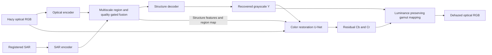

# SAR-guided grayscale recovery and optical color restoration

A PyTorch research framework for paired SAR–optical remote sensing dehazing on
MRSHaze. It separates structure recovery from color restoration and retains a
differentiable path through both stages. The intended workflow is **GitHub →
Kaggle notebook → saved Kaggle artifacts**, as in your RSHazeNet experiments.

Start with [train_kaggle.ipynb](train_kaggle.ipynb), then
[test_kaggle.ipynb](test_kaggle.ipynb). Push this directory's code to GitHub first.
The notebooks assume `https://github.com/sumire25/grayToColor.git`; change
`REPO_URL` if your new repository has a different URL. No repository has been
created or pushed automatically.

The current default is **six E2E epochs with an eight-hour per-session training
budget**, replacing the initial 100-epoch hybrid experiment. Both stages train
from the first batch. See [TRAINING.md](TRAINING.md) for the complete training
protocol, augmentation, validation, learning rates, checkpoint lifecycle,
time-guard behavior, and Kaggle continuation instructions. Six epochs are a
runtime-oriented starting point, not a claim of convergence or measured E2E
runtime on your GPU.

## Model



**Stage 1 — structure.** Separate optical and SAR encoders operate at three
resolutions. At each resolution, a learned SAR alignment layer and feature
discrepancy detector estimate where SAR guidance may help. Coarse fusion then
estimates channel reliability before refined fusion. Residual optical paths
retain image information. A U-Net decoder predicts a residual in the hazy
luminance's logit space, producing recovered grayscale in `[0,1]`.

**Stage 2 — color.** Another U-Net receives the recovered grayscale, hazy RGB,
hazy chrominance, a region map, and multiscale structure features. It predicts
chrominance corrections relative to the observed optical colors. This is
conditional color restoration: SAR supplies structural evidence, while the
optical input supplies color evidence. Both U-Nets use depthwise gated blocks
and global channel attention at their bottlenecks; no Mamba/CUDA extension or
pretrained download is required.

RGB is reconstructed using full-range BT.601 YCbCr in display RGB space. A
per-pixel chroma contraction keeps RGB in gamut while preserving recovered Y.
An unrestricted RGB refinement head would break that separation, so the model
has no such head. Grayscale here means optical luminance, not SAR intensity.
This constrains the decomposition but does not guarantee correct colors where
the optical color evidence has been lost.

Joint RGB/color losses reach the structure network through luminance, feature
connections, and the region map. Auxiliary grayscale losses remain active
during joint fine-tuning to keep the first stage interpretable.

## Relation to the provided papers

- [Zhao et al., DehazeMamba](https://doi.org/10.1109/JSTARS.2025.3634360)
  (`Zhao2026.pdf`) motivates spatially selective SAR guidance, quality-aware
  progressive fusion, MRSHaze, and spatial/frequency reconstruction losses.
  The fusion implemented here is convolutional; it does **not** reproduce
  DehazeMamba's CSS2D/Mamba, HPDM, or PFM algorithms.
- [Fu et al., grayscale image colorization](https://doi.org/10.3390/rs16193644)
  (`Fu2024.pdf`) motivates a dedicated grayscale-to-color stage and combining
  local detail with global context. The implementation here uses supervised,
  deterministic chroma restoration. It does **not** implement Fu's U-ViT,
  feature-statistics discriminator, or discriminator-driven denoising GAN.

The two-stage composition, luminance constraint, feature connections, losses,
and schedules are design choices for this project. This is a new experimental
baseline, not a claimed paper reproduction or a validated improvement over
either paper. MRSHaze training and GPU benchmarking still need to be run.

## Dataset

The default root matches [tp.md](tp.md):

```text
/kaggle/input/datasets/markosumire/mrshaze/MRSHaze/
  train/
    hazy/01001.png ... 07000.png
    SAR/01001.png  ... 07000.png
    GT/01001.png   ... 07000.png
  test/
    hazy/00001.png ... 01000.png, 07001.png ... 08000.png
    SAR/<same IDs>.png
    GT/<same IDs>.png
```

Folder names are case-insensitive. Pairing uses complete filename stems and
fails on missing or extra modalities. Image dimensions must agree; the loader
does not resize or register images. All random crops, padding, rotations, and
flips are shared across SAR, hazy RGB, and GT. Optical inputs are 8-bit PNGs.

Default SAR input is one channel. Unsigned 8-/16-bit PNGs are divided by their
dtype maximum; RGB SAR renderings are averaged to one channel. For genuinely
multichannel PNGs, set **both** `data.sar_channels` and `model.sar_channels` to
the stored channel count. A custom positive `data.sar_scale` can override the
divisor. No per-image min/max normalization is applied. Leave `sar_log1p: false`
for rendered PNGs; only enable it deliberately if appropriate to your encoding.
This loader is for the described PNG dataset, not raw geospatial SAR products.

The default deterministic split reserves 600 of the 6,000 training triplets for
validation, leaving 5,400 for optimization. Split IDs are saved in `split.json`
and checkpoints. Training never opens the test split. The holdout is by image
ID, not geography: source-scene metadata would be needed for a geographic
generalization study. The provided test partition is preserved.

## Training modes

| Mode | Schedule | RGB gradients into structure |
| --- | --- | --- |
| `hybrid` | Grayscale warm-up → frozen-structure color warm-up → joint fine-tuning | During joint phase |
| `e2e` (default) | Joint training from epoch 1, for the sum of configured phase epochs | Throughout |
| `modular` | Same phase lengths as hybrid, with all structure-to-color connections detached | Never |

Default lengths are 0/0/6 epochs: six joint epochs, with a one-epoch learning-rate
warm-up and no separate stage warm-up. To run hybrid/modular warm-ups, explicitly
set nonzero `gray_epochs` and `color_epochs`; changing only the mode will not
create warm-up epochs. The original 10/10/80 schedule is no longer the default.
During an explicitly configured color warm-up, optional ground-truth grayscale mixing
decreases from 0.5 to zero. Structure is frozen, including all feature and map
connections. A single color warm-up epoch uses predicted grayscale only.
Joint training and inference always use predicted grayscale, with no teacher.
Structure parameters use half the colorizer's learning rate during joint
training. Each phase has its own warm-up/cosine schedule. `modular` still
updates the structure model with its own losses during its final phase.

Losses, configured in [mrshaze.yaml](mrshaze.yaml):

| Term | Weight | Applied in |
| --- | ---: | --- |
| Luminance L1 | 1.0 | Grayscale and joint |
| Luminance SSIM | 0.2 | Grayscale and joint |
| Luminance finite-difference edges | 0.1 | Grayscale and joint |
| RGB L1 | 1.0 | Color and joint |
| Chroma L1 | 0.5 | Color and joint |
| RGB SSIM | 0.2 | Color and joint |
| Complex FFT L1 | 0.05 | Color and joint |
| Region-map BCE | 0.05 | Grayscale and joint, with SAR enabled |

Region supervision uses `mean(abs(hazy − GT), RGB) / 0.25`, clipped to `[0,1]`,
as a training proxy. It is not a physical haze/transmission label. Random SAR
dropout, default 0.1, reduces dependence on the auxiliary modality; dropped
samples are excluded from region-map supervision.

## Kaggle execution

1. Push the implementation to your GitHub repository and upload/open
   `train_kaggle.ipynb` in Kaggle.
2. Enable Internet and a GPU; attach MRSHaze. Check `REPO_URL` and `DATA_ROOT`.
3. Run the notebook. It clones the repository, installs dependencies, writes the
   effective configuration, and trains into `/kaggle/working/runs/sar_gray_color`.
4. Save the notebook output. In `test_kaggle.ipynb`, attach that saved output and
   MRSHaze, then set `WEIGHTS` to the mounted `best.pt`. The testing notebook
   clones the repository and writes `/kaggle/working/results/sar_gray_color`.

The implementation uses one GPU; two Kaggle T4s are not automatically combined.
If memory is insufficient, lower `BATCH_SIZE` from 4 to 2 or 1, or reduce the
crop/width. Gradient accumulation is available. The reported grayscale-only
run took approximately 27 minutes per training epoch before validation; this
does not establish E2E epoch duration. The time guard allows a normal early
finish if all six E2E epochs do not fit.

Equivalent commands from the cloned repository:

```bash
python train.py --config mrshaze.yaml
python train.py --config mrshaze.yaml --max-hours 8
python train.py --config mrshaze.yaml --mode modular --run-dir /kaggle/working/runs/modular
python infer.py --weights /kaggle/working/runs/sar_gray_color/best.pt --save-aux
```

For a new SAR ablation set `model.use_sar: false`; for image-only stage coupling
set `model.use_structure_features: false`. That second ablation retains the
grayscale and region-map inputs. Set `train.teacher_start: 0` to remove teacher
mixing. Use separate run directories for experiments.

## Resume across Kaggle sessions

Use `STOP_AFTER_EPOCH` in the training notebook to stop after a complete epoch
without changing the total schedule. For example, stop after epoch 3 of 6, save
the output, then attach it to a new session and set `RESUME` to its `last.pt`.
The notebook reloads the saved config and allows the data/output mount paths
to change. You can also use the saved config directly:

```bash
python train.py --config /kaggle/input/YOUR_ARTIFACT/config.yaml \
  --resume /kaggle/input/YOUR_ARTIFACT/last.pt \
  --data-root /kaggle/input/datasets/markosumire/mrshaze/MRSHaze \
  --run-dir /kaggle/working/runs/sar_gray_color
```

Full checkpoints contain model, optimizer, AMP scaler, completed epoch, best
phase metrics, configuration, split IDs, Python/NumPy/PyTorch RNG states, and
training-loader generator state. Learning rate is derived from the saved
schedule and epoch. Checkpoints are written atomically at epoch boundaries;
an interruption during an epoch resumes from the previous completed epoch.
An initialization checkpoint at epoch zero provides a restart if no epoch has
completed yet. The optional eight-hour guard checks between training batches
and validation images; incomplete epochs are discarded, not mislabeled as
completed. It first tries to avoid starting an epoch that will not fit. Its
clock checks are negligible relative to training, but it cannot interrupt a
stuck operation or guarantee outputs survive cancellation or infrastructure
failure. Successful notebook completion is the intended artifact-saving path.
The budget is per training invocation and refreshes on resume. Available
earlier best checkpoints and metric history are copied from the mounted resume
directory into a new output directory.
Resume preserves the experiment settings; use `--init-weights` and a new run
directory to start a different schedule from existing model weights. Keep the
same code revision and data contents for comparable continuation. Exact CUDA
bitwise reproducibility is not guaranteed.

Artifacts:

- `last.pt`: initialization/restart checkpoint at epoch zero, then a continuation
  checkpoint after every completed epoch and its scheduled validation.
- `best_gray.pt`, `best_color.pt`, `best_joint.pt`: phase-specific best models.
- `best.pt`: best validation model from the **final configured phase** only.
  It does not exist yet if training has not reached that phase.
- `config.yaml`, `split.json`, `environment.json`, `metrics.jsonl`.
- `session_stop.json`: time-guard stop reason and last completed epoch, if stopped early.
- `source_revision.txt`: Git revision recorded by the Kaggle training notebook.

## Evaluation and inference

`infer.py` loads architecture and SAR preprocessing from the checkpoint. GT is
used only for scoring. `--no-gt` supports paired hazy/SAR inference with no GT
folder. `--split val` evaluates the saved training holdout. A grayscale-only
checkpoint is rejected for RGB evaluation because its colorizer is untrained.
Epoch-zero checkpoints are also rejected for evaluation.

Outputs are `rgb/*.png`, optional `gray/*.png` and `haze/*.png`, `per_image.csv`,
and `summary.json`. Both dehazed and hazy-input baseline scores are included.
Metrics are averaged per image at full native resolution:

- PSNR on RGB `[0,1]`, SSIM with an 11×11 Gaussian valid window, and RGB MAE.
- RGB spectral angle in degrees; ERGAS with spatial ratio 1.
- Recovered-luminance PSNR and SSIM.

RGB SAM is only a three-channel color metric. ERGAS can be large for near-black
reference channels; means use a numerical floor. PSNR is capped at 120 dB for
identity fixtures. There is no border shaving or reference resizing. Match
these details before comparing with published scores.

Default inference is full frame. Use `--tile-size 256 --overlap 32` for lower
memory; overlaps use weighted blending. Global channel attention means tiled
results can differ from full-frame results. Inference defaults to fp32;
`--amp` enables optional CUDA fp16.

Inference metrics are calculated before PNG quantization. To reproduce a
saved-image evaluation protocol, use:

```bash
python evaluate.py --predictions /kaggle/working/results/sar_gray_color/rgb \
  --targets /kaggle/input/datasets/markosumire/mrshaze/MRSHaze/test/GT
```

`evaluate.py` requires exact prediction/GT ID sets and reports scores on the
exported 8-bit PNGs. Floating-point and PNG scores can differ slightly.

## Code checks

The test suite uses small synthetic triplets; it does not require MRSHaze:

```bash
pip install -r requirements.txt pytest
python -m pytest -q test_framework.py
```

It checks color conversion/gamut constraints, cross-stage gradient routing,
teacher isolation, SAR ablation, paired augmentation and split integrity,
16-bit SAR scaling, finite losses and metrics, tiled coverage, phase freezing,
exact CPU checkpoint continuation, inference export, and saved-PNG scoring.
It also simulates time limits during training, validation, and between epochs,
then verifies that resuming the preserved checkpoint matches uninterrupted training.
These are implementation checks, not dataset quality results.
